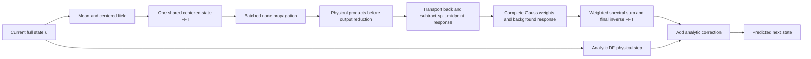

# Resolve: the bounded development program after Advance

This program implements every next experiment in the [full Advance review](reviews/advance-full-native-20261011.md). It preserves historical protocols and results. `full` means the complete **development** portfolio; it does not mean fresh scientific confirmation. Model and optimizer changes informed by this program require a separately frozen future confirmation cohort.

Use `scripts/fedora_resolve.sh` on the existing Fedora project at `/home/rahel/TDN`. All files remain inside the checkout, using its Python venv. The desktop partition is `local`, with eight physical CPU cores, 110000 MiB Slurm memory and a single RTX 4090. Requests use at most 48 GiB host memory and one GPU; the existing 18 GiB/75% soft and 90% hard VRAM policies remain unchanged. No allocation exceeds **35 minutes**, below the user's 45-minute maximum. No pending-job cap or automatic budget expansion is introduced.

## Questions, controls and stopping rules

| Path | Question and falsifiable expectation | Essential controls | Primary measurements and decision |
|---|---|---|---|
| R1 — fitting | Does an accurately optimized two-coefficient rule outperform the previous optimization, or is the basis itself limiting? | Unit gains; fitted quadratic without cubic; fitted quadratic with unit cubic; fitted cubic with unit quadratic; joint direct fit; identical-objective Adam/tanh; GL2/GL4/nested rule | Numerical training-objective gap, held-out RMS/max and reference uncertainty, gain values and basis Gram matrices. Improving the parent without beating GL4 does not justify a solver claim. |
| R2 — finite-step physics | Where do quadrature, leading cubic truncation, spatial discretization and unresolved-scale closure dominate? | Same fields crossed with independent diffusion and reaction stiffness; GL2/GL4/GL8/GL16 interactions, raw/filtered cubic, nested cubic, DF and ETDRK4 | Accepted refined references, vector error decomposition including signed cross terms, basis correlations and field/step identities. Unresolved targets remain NA. |
| R3 — neural fairness | Did short-trial ties hide useful FNO optimizer settings? Can the residual model fit a small task decisively? | Every optimizer gets a long opportunity, equal-time diagnostic and separate tiny-set trial; scaled FNO, mean-separated FNO and two-basis; frozen physical controls | Actual updates/time/censoring, validation-only selection, initialization retention, clipping, parameter movement, mean/spectral/max errors. A tiny-training improvement alone does not establish successful learning. |
| R4 — representation | Can the exact zero midpoint of the DF interaction defect make GL3 useful at two active nodes? | Full sequential GL3; GL2; GL4; nested interaction rule | Quadrature moments, exact-null checks, field-wise error and maximum-error eligibility. Polynomial quadrature degree does not establish full-method temporal order. |
| R5 — execution | Does sharing transforms and batching node responses reduce complete-call work without changing the rule? | Sequential versus batched GL2/GL4; GL3 with/without midpoint work; identical dtype, DF backbone and schedule | FP32/FP64 parity, raw randomized paired timing, first call, warm samples, allocator probes, separate operator profiles. Only jointly accuracy-eligible calls support descriptive cost ratios. |
| RX — protected exploration | Can noise-aware memory beat a simple validated deterministic damping rule? | Coarse RK4, plain secant, damped/decaying secant, clean fitted memory, noise-aware fitted memory | Autonomous trajectories, clean/noisy RMS and sampled max, reaction shift, startup and fitting costs. Retain zero-gain selection and negative findings; no larger model is automatically authorized by failure. |

R1–R3 resolve attribution and fairness; R4–R5 pursue grounded numerical and execution improvements. RX has its own CPU allocation and does not depend on a favorable fit or FNO result. Its maximum scientific allowance is 900 seconds in full, with a 20-minute allocation including overhead. The tested simple rational substitutions are retired for this workload; their historical failures remain preserved.

## R1: optimize the physical coefficients directly

For each fixed state/horizon, cache the same FP32 physical fields `S`, `Q` and `C` used by the existing two-basis model. Treat their real affine combination in CPU FP64:

\[
e_j(g)=S_j+g_2Q_j+g_3C_j-y_j,
\quad
L(g)=\sum_j w_j\frac{\operatorname{mean}(e_j^2)+0.1\max(e_j^2)}{d_j}.
\]

The scales `d_j` are fixed baseline/reference loss scales, and independent fields receive equal total weight despite repeated horizons. Every squared affine residual is convex; a maximum of those squares and a positive weighted sum remain convex. The joint domain is `[.25,1.75]²`. The no-cubic control fixes `g3=0` explicitly; it is not a point within the joint model's admissible box.

The direct solver uses supporting affine planes and a small linear program. A nonnegative, unit-sum mixture of valid planes is a lower bound; minimizing that affine mixture over the coefficient box supplies a numerical lower bound on the optimum. We report its gap from the best observed objective, LP feasibility, stopping reason and every iterate. Floating-point calculations do **not** constitute a rigorous arithmetic certificate. Iteration limits and stalled bounds stay visible.

The matched Adam control uses the identical cached real-affine objective and bounded tanh parameterization. It is a controlled new comparison, not a claim to replay the historical stochastic FP32 training exactly. Native FP32 assembly is evaluated separately, including rounding differences against affine FP64 evaluation. Training alone fits the coefficients; validation reports every arm. Conservative estimated-reference-uncertainty sensitivity accompanies parent and GL4 comparisons.

Completed fit records are reused on recovery after objective/binding checks. Interrupted individual optimizers restart with their old progress and measured attempt costs preserved; this is not described as exact iterate-level continuation. FNO trials support optimizer-state continuation through their existing journals.

## R2: separate errors before changing the architecture

The diagnostic uses overlapping triads and aligned harmonics in addition to a grid-relative frequency challenge. These replace the earlier accidental spectral orthogonality. The same continuous field is reused across the Cartesian stiffness intervention:

\[
d=h\lambda_{\rm active},\qquad q=hr.
\]

Diffusion and reaction vary independently. Full panels use `d∈{.1,1,5}`, `q∈{.1,1,3}`, two phases, grids 32² and 64², both spatial tracks and three spectral designs. Each track/grid/design is a separate recoverable unit. This is 18 paired physical cases per unit; modes, phases and field hashes are retained. Repeated variants are not independent fields.

For prediction `p`, same-equation endpoint `u_D`, same-grid Galerkin endpoint `u_G`, and projected fine endpoint `P u_f`, retain

\[
p-Pu_f=(p-u_D)+(u_D-u_G)+(u_G-Pu_f).
\]

The terms distinguish solver approximation, discrete-versus-Galerkin spatial differences, and unresolved-scale closure. Their norms cannot be added as though errors were orthogonal: signed inner-product cross terms are measured and the vector reconstruction is checked. On the continuum track the middle term is zero by construction. RMS here is the declared sampled/nodal metric; it is not silently exchanged for a Nyquist-weighted interpolant norm.

Teachers actually refine time and, for fine continuum comparisons, space. Refinement histories, contraction, roundoff conditions and uncertainty estimates are stored. A nonfinite or unresolved teacher produces unavailable errors and NA comparisons, rather than discarding the case or accepting an apparent gain. Refined targets are estimates, not certified continuum bounds.

## R4–R5: the midpoint-null kernel and transform reuse

The quadratic DF defect integrates a background-weighted transported product minus its split-midpoint counterpart. At the midpoint the difference is exactly zero. On `[0,1]`, GL3 has

\[
\theta=\left(\tfrac12-\tfrac{\sqrt{15}}{10},\tfrac12,\tfrac12+\tfrac{\sqrt{15}}{10}\right),
\qquad w=(5/18,4/9,5/18).
\]

Only the two off-center responses contribute to this specific integrand. **Do not renormalize the remaining weights:** the complete normalized rule still includes the implicit `4/9` weight multiplying zero. Its degree-five polynomial exactness belongs to the quadrature rule, not to the complete nonlinear time-stepper. The physical integrand is generally nonpolynomial and stiffness dependent.



There is no learned coefficient, output compression, future input, lower precision or reusable state cache in these prototypes. Batched GL2/GL4 preserve their respective mathematical rules. GL3 changes the quadrature representation. Keeping those two claims separate is essential.

Full performance panels cover 64² and 128² on both tracks, easy and high-pair fields, two phases and one/two-step schedules. Each method receives the same complete rollout loop and comparable cache opportunity. DF here is an unfused attribution control: its adjacent half-diffusion steps are not fused. These panels therefore cannot establish superiority over the fastest classical solver. References are CPU-generated outside timing. These kernel panels target the specified same-grid equation; R2 supplies the separate fine-grid error decomposition.

Operator traces are collected before optimized comparison and charged separately. FFT counts are **PyTorch invocations with input shapes**, not an assertion that a batched FFT does the arithmetic of one scalar transform. Allocation, copy, reduction and scalar-read invocations remain separate. Raw timing rounds, warmup, first invocation and allocator probes are retained. Neither a warm-process first invocation nor a handful of repeats establishes production cold start or p99 latency. Currency, power, GPU utilization and complete deployment amortization remain unavailable unless actually measured.

## R3: meaningful FNO training opportunities

Every scaled-FNO, mean-separated-FNO and two-basis family receives all three settings:

| Setting | AdamW learning rate | Gradient clipping | Objective multiplier |
|---|---:|---:|---:|
| `clipped` | .001 | norm 1 | 1 |
| `unclipped_scaled` | .001 | none | .01 |
| `lower_rate_unclipped` | .0001 | none | .01 |

In full, each has an 800-update/90-second long cap, a separate ten-second equal-time opportunity, and a 200-update/15-second tiny-set diagnostic. Time limits may censor updates; requested equality is never substituted for achieved work. Tiny trials must meet both normalized objective ≤.01 and final/initial objective ≤.01; unmet time-capped trials remain unresolved. Tiny checkpoints cannot be selected for deployment or held-out comparisons.

There is no short-trial elimination and no first-tied-setting monopoly on long training. Validation selects among eligible long/equal-time checkpoints, including initialization. Training-only diagnostics cannot influence this choice. Curves, optimizer state, initial/selected parameters, head/trunk movement, clipping and physical residual metrics remain visible. A locally adapted FNO is still not a reproduced published benchmark.

## RX: causal memory with explicit noise controls

The coarse state is advanced by RK4, with optional previous-step defect

\[
\delta_n=c_n-\Psi_h(c_{n-1}),\qquad
c_{n+1}=\Psi_h(c_n)+\alpha e^{-\beta r t_n}\delta_n.
\]

The deterministic selector includes `α=0`, so coarse RK4 can win. Damping and ridge parameters use validation only. Noise-aware fitting sees noisy causal features with clean training targets; autonomous deployment receives two startup observations and never refreshes from future truth. Initial observations, teacher cost and selection work are charged.

Full RX has 48 training, 16 validation and 16 development-test fields, 32 autonomous steps, two paired noise draws at each of `σ=0,1e−4,1e−3`, and independent reaction multipliers 1 and 3. Sigma is the standard deviation of real Fourier coordinates, not a mislabeled physical RMS. All methods share the same noise realizations. This is a separate 1D finite-Galerkin formulation probe; it does not establish a 2D continuum closure.

## Execution, evidence and recovery

| Profile | Jobs | Requested allocation ceiling, summed | GPU allocation ceiling, summed | Purpose |
|---|---:|---:|---:|---|
| smoke | 12 | 2 h | 40 min | Integration and native readiness; tiny fits are not scientific evidence |
| development | 12 | 3 h 03 min | 1 h 10 min | Moderate development comparisons |
| full | 28 | 13 h 50 min | 4 h 50 min | Complete bounded portfolio and three paired FNO training seeds |

These are sums of **requested upper limits**, not runtime forecasts or expected charges. Each job is 10–35 minutes; actual elapsed allocation and CPU accounting are collected separately. Existing single-node serialization prevents this project overcommitting the workstation. Other projects can still queue independently. Independent research paths do not gain scientific dependencies on a successful fit. The report runs after any outcome and exposes missing/failed stages.

The workflow verifies real Slurm ownership/partition/device, the project venv, source/protocol/software fingerprints and prerequisite seals. Every GPU stage requires the exact complete **20-case native CUDA suite**, with no missing, duplicated, failed or skipped cases. Local CPU tests do not satisfy this gate.

`recover` reuses completed sealed units and preserves the original workflow. Compatible fit/fairness attempts retain journals and costs. Other interrupted units restart in new directories. Changing source, software or protocol invalidates recovery; do not pull new code into an active run. Exports include recovery ancestors and failed attempts, and compact packing keeps exact retained evidence bytes. No original result is overwritten.

The atlas includes coefficient behavior, objective curves, interaction error/decomposition, FNO training and validation, accuracy–cost comparisons, operation profiles, noise/rollout behavior and stage costs. Ours use triangle markers, analytic controls squares and Theirs circles. Lines are thin; dense training ranges use continuous translucent low–high bands with opaque boundaries. These are observed ranges, not confidence intervals. Missing validation measurements stay gaps. Raw measurements and hashes accompany summaries.

## Runbook

On the configured Fedora machine:

```bash
cd /home/rahel/TDN
git pull --ff-only
bash scripts/fedora_resolve.sh plan --smoke
bash scripts/fedora_resolve.sh run --smoke
```

After the jobs finish:

```bash
bash scripts/fedora_resolve.sh status latest
bash scripts/fedora_resolve.sh validate latest
bash scripts/fedora_resolve.sh paths latest
bash scripts/fedora_resolve.sh logs latest --lines 120
```

When smoke validation passes, schedule the full declared portfolio:

```bash
bash scripts/fedora_resolve.sh plan --full
bash scripts/fedora_resolve.sh run --full
```

After completion, retain the explicit run ID printed by `run`:

```bash
bash scripts/fedora_resolve.sh validate latest
bash scripts/fedora_resolve.sh collect latest
bash scripts/fedora_resolve.sh compact latest
```

The default compact exporter uses its current fast compression settings. Do not request XZ preset 9 for ordinary uploads. Upload the resulting index and every numbered part. To diagnose and recover a compatible interruption:

```bash
bash scripts/fedora_resolve.sh logs latest --lines 200
bash scripts/fedora_resolve.sh recover latest --plan
bash scripts/fedora_resolve.sh recover latest
```

For cloud CPU development only, outside Slurm:

```bash
bash scripts/resolve_local.sh --smoke
```

This command is not a replacement for native GPU verification. Full scientific execution remains allocated on Fedora.
