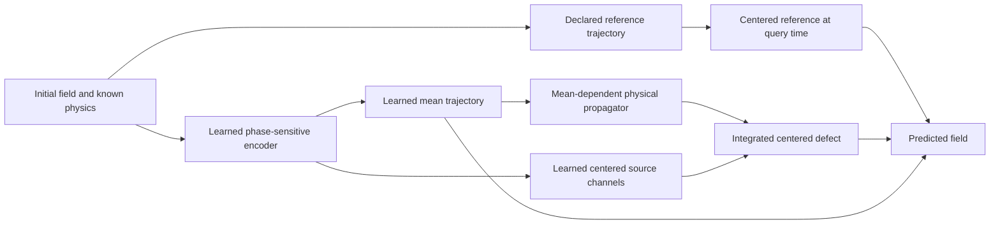

# TDN next research handout: learned finite-time dynamics with verified physical structure

**Status:** implementation and research specification, 11 October 2026. The new program described here has **not** been implemented or run by the act of writing this document. Historical measurements, side-conversation numerical probes, exact identities, and proposed mechanisms are distinguished below.

**Purpose:** give the main implementation agent a complete, reviewable route from the Advance/Resolve findings to a genuinely learned operator, including mathematics, software, data, training, tests, evaluation, resource limits, recovery, and reporting. This is a staged research program with explicit failure outcomes, not a promise that the proposed architecture will win.

**Reading map:** Sections 0–6 define the assignment, evidence, mathematics, and architecture; Sections 7–11 define data, learning, controls, tests, and scientific decisions; Sections 12–17 define costs, implementation, execution, reports, and handoff. Appendix A supplies reproducible mechanism probes; Appendix B closes additional fairness/identifiability gaps; Appendix C specifies the decision and release record. Read the entire document before freezing the protocol.

## 0. Copyable instruction to the main agent

> Read `AGENTS.md` and this entire handout before implementation. Implement the staged program in a new namespace, preserving all existing experiments and measurements. Start with independent mathematical checks, reference/precision contracts, and the diverse trainability pilot. Progress through the gates in this document; do not expand an unsuccessful architecture merely to complete a large campaign. Build runnable local CPU checks, mandatory native CUDA checks, recoverable Fedora workflows, complete reports, compact exports, and an exact desktop runbook. Distinguish implemented functionality, CPU evidence, native GPU evidence, development findings, and untouched confirmation. Resolve routine implementation details independently, record substantive deviations, and retain negative findings. Do not silently replace an equation target, change an acceptance threshold after seeing results, omit failed trials, or claim numerical speedups from neural accuracy alone. Produce concrete code and validation evidence before handing over execution commands. Do not submit new desktop jobs or publish externally unless the active main conversation authorizes those actions.

Suggested program name: **Response**, meaning the learned finite-time response. Use `tdn.analysis.response`, `scripts/fedora_response.sh`, `runs/.fedora-response-latest.json`, and `docs/RESPONSE_RESEARCH.md`. These names are proposed interfaces, not existing commands. If they conflict with concurrent work, choose a distinct name once and update every reference consistently.

## 1. Research objective and claims we are entitled to test

The intended TDN is a learned map from an initial field, physical parameters, geometry, and requested time to a future field. A small neural network selecting two global or state-dependent gains is a restricted learned correction; it does not exhaust this objective. FNO is also a learned neural operator. A fitted two-coefficient numerical rule and a field-to-field neural operator are different levels of representation, even when both are trained.

Our primary architectural question is:

> Can a neural representation of the nonlinear finite-time response learn more accurately, efficiently, and reliably than credible alternative neural operators, using physically correct propagation and the same available information?

There are three separate claim families:

| Claim | Decisive comparisons | What is insufficient |
|---|---|---|
| Learned-operator contribution | Competently trained direct FNO, matched-backbone residual FNO, original learned TDN, learning curves and held-out generalization | Beating an undertrained or badly scaled FNO |
| Value of learning within our method | Frozen physical parent, optimized analytic controls, fixed-feature linear fit, learned versus frozen encoder | Beating an obsolete normalization or fitting only two gains |
| Useful complete solver | Accuracy-qualified classical and analytic frontiers, all inference costs and deployment workload | Fewer parameters, fewer quadrature nodes, or same-schedule error alone |

Numerical solvers remain essential references, attribution controls, and practical alternatives. They need not be the sole primary competitors for a neural-architecture paper. Conversely, calling a model a neural operator does not exempt a claimed solver speedup from comparison with numerical solvers. Report a neural accuracy/data-efficiency contribution if established even when the complete solver is slower; report that cost limitation explicitly.

Do not claim resolution generalization merely because weights accept another array size. Demonstrate the correct physical operator, spectral support, normalization, and behavior on paired continuous fields at the new resolution.

## 2. Evidence that motivates this specification

Read these existing records; they are source material, not files to overwrite:

- `docs/reviews/advance-full-native-20261011.md`.
- `docs/reviews/resolve-full-native-20261011.md`.
- `results/resolve-native-review/README.md` and its `details/` analyses.
- `docs/RESOLVE_RESEARCH.md`, `docs/IMPLEMENTATION_SPEC.md`, `docs/IMPLEMENTATION_MAP.md`, and the current applicable Fedora instructions.

The main Resolve findings are:

1. Direct optimization largely exhausted the two-gain family. Its mean RMS improved approximately 7.9–11.0% over its parent, but remained approximately 2.8–3.1 times GL4's error.
2. Approximately 72–75% of that candidate's pooled squared error lay in the mean. This is an observation about that candidate and cohort; remeasure it after changing the anchor.
3. The leading filtered cubic direction opposed the remaining GL4 defect in 149/216 constructed conditions. More gain optimization cannot manufacture a missing residual direction.
4. Nested finite-time interactions were much stronger in many cases, but were neither free nor universally beneficial. Quadrature convergence and cancellation still matter.
5. Shared-transform GL4 was 1.47–2.26 times faster than sequential GL4 on the measured 4090 conditions, with numerical parity. It is the strengthened analytic implementation control, not proof of fastest-solver performance.
6. FNO training received more credible opportunities, yet its scaling and tiny-fit behavior remained concerning. The polynomial output scale is a plausible cause requiring an intervention, not an established sole cause.
7. Clean-history memory helped some tasks but amplified noise. Validation selected zero memory gain in the mixed-noise setting. A denoising observation process and autonomous dynamics cannot be conflated.

The Advance and Resolve results have informed design. They are development evidence for this new program. Do not reuse their confirmation fields as untouched confirmation. The side-conversation probes in Appendix A are also development evidence and must be reproduced as artifacts before being cited as new campaign results.

## 3. Decisions from the second verification pass

The recommended primary direction is a **learned full nonlinear trajectory defect**, with a **coupled mean and spatial response**, followed by **compression that preserves the effect of a source on the final prediction**.

The following are deliberate revisions to an overly narrow interaction architecture:

- Do not restrict the learned correction to a quadratic-plus-leading-cubic amplitude expansion. Such an expansion can fail within physically valid inputs.
- Use quadratic, nested cubic, commutator, and phase-sensitive products as features, attribution controls, and optional analytic components. Their inclusion is an experiment, not an unconditional requirement.
- Do not make the mean head depend only on mean and power spectrum. Phase-related interactions can change the missing mean correction.
- Do not repair the mean only after propagating spatial structure with the wrong reaction background. Compare that ablation with coupled propagation.
- Do not impose a diffusion-zero null or an `h^3` onset on a coarse-to-fine closure. Those restrictions belong to particular same-equation splitting defects under exact-subflow assumptions.
- Do not force every latent mode to decay. Reaction can amplify perturbations, including unresolved modes.
- Keep noisy-history inference in a protected, separate experiment until its information and observation model is sound.
- Do not choose an elaborate decoder before establishing that a simple, properly scaled learned correction can fit diverse small examples.

The first implementation should be transparent and independently checkable. Optimize and compress it only after the mathematical and learning gates pass.

## 4. Equation, representation, and target contracts

### 4.1 Common finite equation

Use the autonomous periodic logistic reaction–diffusion family

\[
u'=f(u)=Lu+r u-rB(u,u),\qquad r\ge0,\quad L=\kappa\Delta,\quad\kappa\ge0.
\]

Here `B` is part of the equation definition:

- **FD/nodal:** `L` is the specified periodic finite-difference diffusion operator; `B(a,b)=a*b` at nodes.
- **Same-grid Galerkin:** `L` uses the declared Fourier symbol; `B(a,b)=P_N(ab)` with the repository's dealiased product and Nyquist convention.
- **Projected fine target:** solve the specified fine Galerkin equation and project its solution to the coarse representation. This is a different target from integrating the coarse Galerkin equation.

Use unambiguous identifiers such as `fd_same_grid`, `galerkin_same_grid`, and `galerkin_projected_fine`. Retain old `continuum` labels only in imported historical records, with an explicit mapping. A converged finite system is not automatically a converged continuum solution.

Record dimension, physical box lengths, grid, boundary conditions, diffusion symbol, product implementation, Fourier normalization, projection, dtype, and target kind with every dataset and checkpoint. Domain length changes the physical wave numbers; array indices alone are not enough.

### 4.2 Metrics and inner products

For FD, the primary sampled RMS is the normalized nodal Euclidean norm. For Galerkin, report both the sampled error used for practical comparisons and the physical interpolant norm used in identities. They can differ at even-grid Nyquist modes.

Use the existing verified Fourier-resampling convention. Under full `fftn(..., norm='forward')` coefficients, interpolant Parseval masses have a factor `1/2` for each axis at an even-grid Nyquist index. A corner Nyquist mode in two dimensions has mass `1/4`. An `rfft` representation also needs conjugate multiplicities; do not copy the full-spectrum weights without adjustment.

Projection and the inner product must make the claimed Galerkin identities valid. Never replace a nested projected product `B(a,B(b,c))` with a single projection of `a*b*c` without proving equality for the specific supports. Galerkin multiplication is generally nonassociative.

### 4.3 Three distinct residuals

For a coarse initial state, distinguish:

1. Same-equation temporal defect: exact/refined coarse solution minus the deployed coarse backbone.
2. Spatial-operator discrepancy: FD versus same-grid Galerkin, under an explicit common representation.
3. Unresolved-scale closure: projected fine solution minus the solution of the coarse equation.

Train and score these separately first. A later combined model must expose which channel addresses which target. For compatible vectors, verify

\[
p-Pu_f=(p-u_D)+(u_D-u_G)+(u_G-Pu_f).
\]

Store all signed pairwise inner products in the squared-error decomposition. Summing component norms destroys cancellation information.

## 5. Mathematical foundation to implement and independently verify

### 5.1 Logistic background transformation: exact, but not automatically numerically safe

Let `c0` be the initial mean and let the homogeneous logistic solution and its initial-value derivative be

\[
D_t=c_0+(1-c_0)e^{-rt},\qquad
c(t)=\frac{c_0}{D_t},\qquad q(t)=\frac{e^{-rt}}{D_t^2}.
\]

Writing `u=c+q w` gives the exact finite-equation identity

\[
w'=Lw-rq(t)B(w,w),\qquad w(0)=u(0)-c_0.
\]

`c(t)` is a homogeneous background, not the actual evolving mean. `w` does not remain mean zero. This transformation explains useful physical kernels; it does not authorize dividing training labels by an arbitrarily small `q`. Use stable forward response factors, endpoint limits, and exact constant branches. Handle `r=0`, `h=0`, `c0=0,1`, exponent underflow, and large `rh` without `0*inf` or hidden clipping.

For `0<=s<=h`, a useful ratio is

\[
q(h)/q(s)=e^{-r(h-s)}(D_s/D_h)^2.
\]

Evaluate this stably or use a log-domain equivalent where needed. This scalar factor can amplify as well as damp, depending on the background.

### 5.2 Full reference-trajectory defect: the primary identity

Choose a differentiable reference trajectory `a(t)` with `a(0)=u0` and define its equation residual

\[
\rho(t)=a'(t)-f(a(t)).
\]

For `e=u-a`, the **exact** error equation is

\[
e'=Le+r e-2rB(a,e)-rB(e,e)-\rho,\qquad e(0)=0.
\]

This identity retains arbitrary input amplitude. It is not a cubic-amplitude truncation. The proposed neural model compresses or approximates its finite-time response. It must not silently drop the nonuniform linear potential or nonlinear error feedback and then describe the result as exact.

A useful analytic first response is

\[
e_0(h)=-\int_0^h \frac{q(h)}{q(s)}H(h-s)\rho(s)\,ds,
\qquad H(t)=e^{tL}.
\]

It replaces the true nonuniform response by a homogeneous background response. It is an approximation, an offline target/control, and a possible feature—not the final exact solver. Record the effects of the omitted terms `-2rB(a-c,e)` and `-rB(e,e)`.

For the nodal exact-subflow Strang path,

\[
y(t)=H(t/2)u_0,\quad z(t)=\Phi_t(y(t)),\quad a(t)=H(t/2)z(t),
\]

its derivative is

\[
a'(t)=\tfrac12La(t)+H(t/2)
\left[r z(t)(1-z(t))+\tfrac12\Phi_t'(y(t))Ly(t)\right].
\]

This gives a differentiable, independently checkable `rho`. The pointwise derivative formula does **not** apply unchanged to projected Galerkin reaction. There, differentiate the actual declared reference path, or integrate the projected reaction tangent equation. Record any numerical subflow error. A finite-difference trajectory derivative is a diagnostic control, not the preferred high-accuracy production formula.

The reference may be one-step DF, a short fixed composition, or an interpolated numerical trajectory. Its entire construction cost counts. An endpoint-only routine is not automatically a valid continuous reference path. At composition boundaries use consistent piecewise residual integration and continuity; include jumps explicitly if a path is discontinuous.

These differential identities concern a differentiable mathematical reference, approximated in FP64 for verification. Floating-point rounding makes the literal deployed map a different object; autodifferentiating floating-point operations does not differentiate its rounding discontinuities. Keep physical source labels tied to the smooth reference and handle the deployed-anchor discrepancy through the explicit precision/remainder contract in Section 7.5. Do not claim an exact continuous residual identity for a rounded trajectory without accounting for that distinction.

### 5.3 Coupled actual mean and spatial dynamics

Define the actual mean `m`, centered field `v=u-m`, and consistent variance `V=<v,v>`. Then

\[
m'=r[m(1-m)-V],
\]

\[
v'=Lv+r(1-2m)v-r[B(v,v)-V],
\]

\[
V'=2\langle v,Lv\rangle+2r(1-2m)V-2r\langle v,B(v,v)\rangle.
\]

Constants here denote constant fields where necessary. For Galerkin, use the physical inner product and compatible projection. These equations show why mean, variance, skewness/phase, and spatial damping interact. An endpoint mean overwrite alone cannot correct a spatial trajectory propagated with the wrong `m(t)`.

Given a mean trajectory, the scalar-background propagator is

\[
G_m(t,s)=\exp\left((t-s)L+r\int_s^t[1-2m(\tau)]\,d\tau\right).
\]

For a reference `a=ma+va`, set `d=v-va`, `P0 x=x-mean(x)`, and `rho_c=P0 rho`. The exact centered defect equation is

\[
d'=Ld+r(1-2m)d+F,
\]

\[
F=-\rho_c-2r(m-ma)va
  -rP_0\{2B(va,d)+B(d,d)\}.
\]

Consequently `d(h)=integral_0^h G_m(h,s) F(s) ds`. This is the precise contract for the coupled neural source decoder below. It prevents accidental double correction of the mean and identifies the feedback omitted by a linear-response approximation.

### 5.4 Optional bounded mean clock

For a genuinely bounded nodal/continuum state `0<=u<=1`, `0<m<1`, define

\[
z(t)=V(t)/[m(t)(1-m(t))].
\]

Then `0<=z<=1` and

\[
m(h)=\operatorname{sigmoid}\left(\operatorname{logit}(m_0)
  +r\int_0^h[1-z(s)]\,ds\right).
\]

The exact endpoint bounds are `m0<=m(h)<=Phi_h(m0)`. A learned causal `z` could give a bounded mean decoder coupled to the spatial trajectory. Endpoint constants require exact branches rather than clipped logits.

This is conditional structure. Finite Galerkin dynamics can leave the physical interval, and noisy observations may start outside it. Do not impose these bounds without validating the assumptions. Compare against the existing deterministic moment model in `tdn/analysis/roadmap/numerics.py`; the normalized-variance idea already exists in this project. A mean clock is not automatically a novel technique or a successful closure.

The predicted variance must agree with the reconstructed field within declared tolerance. An unconstrained latent variance and a separate field can otherwise give an internally inconsistent mean. Measure that disagreement and ablate a consistency penalty; do not claim the identity is enforced when only penalized.

### 5.5 What the interaction formulas do—and do not—capture

For a quadratic interaction `p+q=k` with diffusion eigenvalues `lambda`, the zero-subtracted scalar kernel contains

\[
K_{k,p,q}(h)=\int_0^h q(s)
\left[e^{-\lambda_k(h-s)-(\lambda_p+\lambda_q)s}
-e^{-(\lambda_k+\lambda_p+\lambda_q)h/2}\right]ds.
\]

The bracket vanishes if `lambda_k=lambda_p+lambda_q`. Geometry, relative wavevector orientation, and intermediate modes therefore matter. A single active-frequency statistic cannot encode all interactions. Triple interactions require their actual nested intermediate projection.

For initial centered `v`, the mean quadratic correction is

\[
\overline{Q_h}=-r q(h)\sum_k\omega_k|\hat v_k|^2
\int_0^h q(s)\,[e^{-2\lambda_k s}-e^{-\lambda_k h}]\,ds.
\]

This is the mean of a quadratic-amplitude coefficient, not an exact nonlinear mean closure. Keep `q(s)`, the correct symbol and masses, and stable small-argument evaluation. In the illustrative `q(s)=1` limit, the integral is

\[
h[\phi_1(-2h\lambda_k)-e^{-h\lambda_k}],\quad
\phi_1(x)=\operatorname{expm1}(x)/x.
\]

The bracket behaves as `(h lambda)^2/6` near zero. Use a series to avoid cancellation. Replace an anchor's mean component once; do not add the same GL4 mean twice.

### 5.6 Why a cubic-amplitude model can fail on valid inputs

For scalar logistic dynamics,

\[
\Phi_h(c+v)-\Phi_h(c)=\frac{q(h)v}{1+\beta(h)v},
\quad \beta(h)=\frac{1-e^{-rh}}{c+(1-c)e^{-rh}}.
\]

Its geometric amplitude expansion requires `|beta*v|<1`. Define `chi=beta*||v||inf` as a diagnostic. A bounded physical initial state can have `chi>1`; low-order terms can then be misleading. This is a scalar expansion criterion, not a universal PDE stability boundary. Stratify by `chi`, mean, amplitude, extrema, localization, and independent stiffness rather than claiming it proves PDE failure.

### 5.7 Closure has different nulls and onset

Let `P` be the coarse projection and start from resolved `u=Pu`. Even at `kappa=0`, projected fine reaction and coarse projected reaction can differ:

\[
P\Phi_h(u)-\Phi_h^P(u)
=r^2h^2P\{u(I-P)(u^2)\}+O(h^3).
\]

Here `Phi^P` is the exact flow of `r(u-Pu^2)`, not projected pointwise logistic evaluation. Initially hidden modes can introduce a difference at first order in time. Consequently a closure is not required to vanish with diffusion or start at cubic time order.

For same-grid symmetric splitting with exact subflows, the local temporal defect is `O(h^3)` under smoothness. An approximate Galerkin reaction subsolver has its own error. State explicitly which component has an exact null; do not suppress the deployed subsolver discrepancy by architecture fiat.

## 6. Proposed neural architecture: implement in increasing difficulty

### 6.1 Model interface and genuine learned content

The public interface should support:

```python
encoded = model.encode(u0, equation, geometry, target_contract)
prediction = model.decode(encoded, horizon)
prediction, diagnostics = model.step(u0, horizon, equation, geometry)
trajectory = model.rollout(u0, step_schedule, equation, geometry)
```

Use scalar-field inputs shaped `[batch,1,Nx,Ny]` initially; the isolated 1D pilot uses `[batch,1,N]`. Define a scalar horizon, one horizon per batch member, and a query axis explicitly: multi-query output is `[batch,queries,1,Nx,Ny]`. Reject ambiguous broadcasting, incompatible grids, negative/nonfinite horizons, and unsupported target/parameter combinations. Test noncontiguous tensors and batch-one versus batched parity. Do not interpret the query axis as another physical spatial dimension.

Keep neural time features dimensionless using a declared `t_ref`; keep source channels in field/time units and endpoint corrections in field units. Document which scalars are differentiable tensor inputs and which are immutable metadata. Parameter-sensitivity tests must not be defeated by converting the differentiated parameter to a Python float.

`encode` may cache information for several queries from the **same current state**. After a physical macrostep, re-encode the new state. Never reuse state-dependent features after the state changes. Static symbols/quadrature weights may be cached separately. Checkpoint identity, dtype/device, state identity, physics, and geometry must bind caches.

State whether an encoder is horizon independent. A model that receives `h` during encoding cannot claim the same multi-query amortization as a single horizon-independent encoding. Implement single-query correctness first; charge every output query's accuracy and all encoding costs before reporting temporal reuse.

The neural encoder must produce spatially varying features/source fields from the input and physical parameters. Train those features and the temporal/mean heads end to end. Keep frozen-encoder and two-global-gain versions as controls. Report trainable parameters, active gradients, parameter movement, and selected initialization; parameter count alone is not expressiveness or cost.

### 6.2 Stage A: an intentionally simple trainability control

Before implementing the final coupled model, build a well-scaled endpoint corrector

\[
\hat u(h)=A_h(u_0)+\delta m_\theta(u_0,h)
             +P_0\delta v_\theta(u_0,h).
\]

`A` is a declared frozen deployed anchor. Test DF first and shared-transform GL4 second. The mean and centered heads receive separate training-only scales with precision floors. This is an ablation/control, not the final coupled physical claim.

Use a small real-field equivariant encoder: lifting pointwise linear layer, two or three periodic residual blocks combining local convolutions and low-mode spectral mixing, smooth activation, and separate mean/centered outputs. Start with width 16 and two blocks as a bounded pilot configuration; width 32 is a capacity diagnostic only after trainability is established. Record retained physical Fourier modes and local receptive field. Do not restrict all nonlinear products to those retained modes before forming them.

This encoder choice is an engineering starting point, not an asserted optimal architecture. A matched residual FNO should have comparable spatial capacity and the same anchor; otherwise a win may be due to backbone or size. Test a fixed-feature linear readout to separate representation failure from nonlinear optimization.

### 6.3 Stage B: learned coupled finite-time source

Implement an auditable reference version of the centered equation in Section 5.3:

1. Construct `a(t)` and its mean/centered parts on a declared temporal collocation grid.
2. Predict a differentiable mean trajectory `m_theta(t)` with `m_theta(0)=m0`.
3. Encode phase-sensitive fields into `J` zero-mean spatial source channels `A_j(x)`.
4. Predict smooth temporal coefficients `b_j(t)` from the state/physics encoding and time.
5. Form `F_theta(t,x)=P0 sum_j b_j(t) A_j(x)`.
6. Decode `d_theta(h)=integral G_mtheta(h,s) F_theta(s) ds` and output `m_theta(h)+va(h)+d_theta(h)`.



The exact source in Section 5.3 supplies supervised diagnostic labels when the reference trajectory is available. It includes the response to the mean discrepancy; training only `-rho_c` and ignoring feedback is a separate linear-response ablation. Endpoint supervision remains necessary because a small source norm is not the same as a small endpoint error.

For the initial implementation, temporal integration may use GL8 with GL16/GL32 refinement checks. It is an oracle/transparent implementation until full-call costs are measured. Repeated reference evaluations are not free. A neural source that evaluates the full expensive reference at every node has not yet achieved temporal compression.

Then implement a compact decoder using cached source spectra and scalar/spectral response kernels. Compare fixed time bases, learned time coefficients, and direct source interpolation before adding more latent dimensions. Pilot ranks `J in {2,4,8}`; select from training/validation only. Rank is a research variable, not a declaration that four channels suffice.

Two acceptable mean parameterizations must be compared:

- An unrestricted correction to the reference mean, with a smooth zero-at-start basis and exact baseline initialization.
- The conditional mean clock in Section 5.4, for targets whose assumptions hold, with its own deterministic initialization control.

Do not silently claim zero initialization reproduces DF for a clock parameterization unless its initialized clock actually reproduces the entire DF mean path. Demonstrate the equality or label the different parent.

### 6.4 Time basis and exact-null policy

Time coefficients must be finite at zero, differentiable where derivatives are required, and have controlled behavior throughout the declared horizon interval. Compare bounded rational time features, exponentials with explicit limits, and piecewise polynomial/spline bases. The earlier poor rational propagation experiments do not rule out rational **parameterizations** of learned time coefficients; they are different claims.

For the ideal same-equation Strang defect, a source onset of order `t^2` yields an endpoint of order `h^3`. A saturating envelope such as `t^2/(t_ref^2+t^2)` can enforce the onset without extrapolating an unbounded polynomial. Its source amplitude still needs physical units and training-only scaling. A bounded envelope does not establish stable rollouts.

Keep a separately labeled numerical-remainder channel if the deployed anchor violates the ideal asymptotic contract. Closure channels use their own derived onset. Learnable weights cannot change exact identity at `h=0`; implement the identity structurally.

For physical nulls, prefer zero-subtracted responses or masks with proved applicability over large penalties. Check nulls for arbitrary random network weights, not just zero initialization. Respect `r=0`, constant inputs, and `kappa=0` only for the component and equation where they are valid. Explicitly state any differentiability loss at a branch.

### 6.5 Features that preserve missing information

Required feature families/ablations:

- Mean, centered field, extrema, variance, and normalized amplitude with safe floors.
- Independent reaction/diffusion/time parameters and the full spatial symbol where used.
- Heat-filtered fields at a small fixed set of physical times or scales.
- Local products and sequential projected products formed **before** output compression.
- Mean-free quadratic/cubic fields, or local nonlinear features that can represent them.
- Phase-sensitive features, such as products linking harmonics or equivalent local products. Power-only features are a negative control.
- Multiple spectral bands in fixed physical wave-number units, not just fractions of the changing grid.

Use spatially shared operations and global invariant conditioning. Avoid absolute coordinate channels unless the physical problem requires them. For real outputs preserve Hermitian symmetry. Test translations, and rotations/reflections only where the geometry and operator actually have those symmetries.

Do not equate phase sensitivity with loss of translation equivariance. Products can retain relative phase while transforming equivariantly under global translations.

### 6.6 Response-weighted compression: the main invention to test

Ordinary energy-based compression can discard a small source whose downstream effect is large. For source approximation error `delta rho`, linearized endpoint error is approximately

\[
\delta u(T)=-\int_0^T J(T,s)\,\delta\rho(s)\,ds,
\]

where `J` is the tangent propagator along the relevant trajectory. The sign follows the chosen residual convention. This formula is first order; nonlinear remainder must be measured.

Compare equal-rank/equal-cost:

1. Unweighted POD/SVD or temporal interpolation of source snapshots.
2. Heat/background-response weighted compression.
3. Learned compression optimized through the actual decoder to endpoint mean, centered RMS, and maximum error.
4. Optional few-probe JVP/VJP weighting for quantities of interest.

Never build full dense tangent matrices at production grid sizes. Charge probe construction to offline training and any deployed probe to inference. Fit compression bases on training data only. Report discarded source energy, propagated error, and goal-specific error separately.

This is a research hypothesis, not a novelty claim. Compare with existing reduced-basis, operator-learning, and goal-oriented reduction ideas before writing a publication claim.

### 6.7 Optional unresolved-state/observer branch

Keep this separate from the main same-grid model. For a known band-limited initial condition, unresolved modes start at zero but are generated by `(I-P)B(u,u)`. Test a small explicit shadow-band state driven by this source, then feed its interactions back to resolved modes. Retain intermediate mode geometry and dealiased projections.

Linearized unresolved rates include `-lambda_k+r(1-2c)`, which need not be negative. Impose stable decay only under a verified spectral-gap condition. Compare learned rates with the actual physical rates and a deterministic shadow-band integration.

If the initial hidden field is unknown, the present coarse state need not determine the future. Evaluate conditional ambiguity with matched coarse states, report irreducible conditional error, and add history/uncertainty only with causal information. A deterministic point predictor cannot recover arbitrary hidden phase from variance alone.

For noisy startup observations, separate an observation encoder/observer from the autonomous dynamical state. Train with the actual observation schedule: two initial observations followed by autonomous rollout, if that is deployment. Do not train repeated clean-target denoising at every step and assume it is an autonomous closure. Include zero-gain, deterministic filtering, damped secant, and coarse RK4 controls at equal information.

### 6.8 Initialization and differentiability

Initialize only the final correction readout/gate to zero while leaving upstream feature/source factors nonzero. A product of several independently zero factors can kill all gradients. A zero final readout may legitimately give zero trunk gradients on the first update; verify that the trunk receives gradients after the readout moves.

Test gradients through the encoder, scalar time kernels, FFTs, projection, mean trajectory, and decoder against finite differences on small FP64 cases. Avoid detach/copy paths that silently freeze physics-conditioned features. For direct variable projection or least squares, state whether differentiation through the solve is used and test rank-deficient cases.

## 7. Data program: variables, splits, references, and precision

### 7.1 Independent unit and split construction

The independent unit is a **parent continuous field specification**, including its shape, relative phases, amplitudes, mean, and physical parameter draw. Its grids, horizons, translations, time slices, noise draws, and training-seed predictions remain grouped with that parent. Keep all descendants in one split.

Use deterministic, namespaced seed derivation from a root campaign seed plus split/parent/role identifiers. Save the generator version and full parent parameters, not only a seed. Hash both the specification and generated arrays. Enforce disjoint parent IDs and detect duplicate/translated-only shapes across splits. A different phase of a single isolated Fourier mode is usually only a translation, not independent shape diversity.

Derive numeric seeds from canonical serialized IDs with a stable digest, not Python's process-randomized `hash()`. For coarse/fine comparisons, distinguish sampling from Fourier projection: simply sampling a high-frequency fine field at coarse nodes can alias hidden modes into the visible state. Construct the declared coarse observation with `P`, and retain nodal sampling as a separately named contract when intended.

Recommended bounded dataset sizes, to be frozen after teacher-cost profiling:

| Profile | Training parents | Validation parents | Development-test parents | Purpose |
|---|---:|---:|---:|---|
| Smoke | 4 | 2 | 2 | Execution only; two optimizer updates are sufficient |
| Trainability/physics pilot | 32 | 16 | 16 | Diverse tiny fits, identifiability, scaling, references |
| Full development | 256 | 64 | 128 | Selected architecture and credible competitors |
| Fresh confirmation | No new fitting | Frozen policy | 128 new parents | A separately registered final comparison |

These are proposed counts, not already acquired data or authority to expand a budget. If reference costs require smaller counts, revise and freeze the plan **before** inspecting candidate outcomes. Never quietly replace hard unresolved parents with easier ones. Keep their missing-reference status and the denominator.

Build nested training subsets of 32/64/128/256 parents for data-efficiency curves. Reuse their paired validation set. Limit initial curves to the selected TDN and strongest trainable FNO; other full Cartesian products are unnecessary. Exploratory one-seed curves must be labeled as such; the final selected operating point uses three paired training seeds.

### 7.2 Coverage and interventions

Start with periodic two-dimensional unit-square fields. Include:

1. Isolated modes and two independent modes for exact/clean controls.
2. Aligned harmonics and overlapping triads with independently varied relative phases.
3. Random smooth spectra with varied slope, bandwidth, and anisotropy.
4. Localized positive peaks and negative holes with matched mean/variance where feasible.
5. Several interacting peaks, interfaces, and broad support, while respecting the declared regularity.
6. Phase twins with identical mean and power but different higher-order interactions.
7. Paired fields with the same coarse state but distinct hidden modes for the closure branch only.

Vary the following independently where physically feasible:

| Variable | Why it cannot be omitted | Initial diagnostic support |
|---|---|---|
| Initial mean | Changes logistic growth, response sensitivity, available variance | Include means near .03, .08, .15, .35, .5, .65, .85, .92, .97 |
| Amplitude/extrema/localization | Low-amplitude expansions can fail on valid large contrasts | Several amplitudes per shape, including near-boundary peaks and holes |
| Reaction and diffusion | Joint scaling tests only a timescale change | Separate `r` and `kappa` draws/interventions |
| Horizon and macrostep | Finite-time representation and rollout errors differ | Include short steps, training horizons, interpolation, and genuine extrapolation |
| Relative phases/mode geometry | Powers do not determine nonlinear transfers | Harmonic signs, triad phases, aligned/nonaligned wavevectors |
| Spectral support | Unresolved generation and decay depend on support | Fixed physical modes and separately labeled grid-relative stress |
| Geometry/operator | Same array size need not represent the same PDE | Record box length, symbol, projection, Nyquist convention |
| Precision/reference quality | Tiny targets may be below deployment resolution | Quantization, target uncertainty, accumulation floors |
| Observation process | Noise/history can change the problem's information content | Clean state first; separate known noisy-startup pilot |

Suggested stiffness supports for designed diagnostics are `r in {0,.5,3,8,25,60}` and `kappa in {0,3e-4,.003,.03}`. Do not exhaust their Cartesian product with all shapes/grids/horizons. Use a fixed designed panel for mechanisms and stratified independent draws for statistical comparisons. Summarize actual `rh`, `h*lambda`, and `chi` coverage.

Use analytic amplitude limits or declared rejection sampling to keep bounded-input families within `[0,1]`. Do not clip generated fields silently: clipping changes the spectrum and field family. Record rejected draw counts and the resulting distribution. Endpoint constants `0` and `1`, `r=0`, and `kappa=0` are exact controls and must not dominate aggregate accuracy through sheer repetition.

### 7.3 Grids and horizons

Primary development uses 32² and 64², with paired continuous fields. The initial training grid may be 32²; distinguish a 32→64/128 transfer model from a separately trained larger-grid model. Use 64²/128² for the bounded native scaling panel after correctness and training pass. High-frequency grid-relative stress is a separate panel because its physical field changes with resolution.

Suggested training horizon support is `[.005,.12]`, using both fixed anchors and nonuniform sampled times. Validation includes held-out times within this interval. Reserve `.18` and `.24` for a declared time-extrapolation development panel only if they have not entered checkpoint/hyperparameter selection. If they are used for selection, relabel them as validation and freeze a different extrapolation panel.

Rollout tests include 1, 2, 4, 8, 16, and 32 macrosteps. Separate fixed total horizon with varying step count from increasing total horizon at fixed step. Before extending to very long horizons, profile teacher cost and distinguish convergence toward a trivial equilibrium from accurate transient dynamics.

All learned methods receive time and physical parameters explicitly when the task varies them. A baseline trained only at a fixed horizon is not a fair comparator to a time-conditioned operator without stating that restriction.

### 7.4 Teacher generation and acceptance

Generate teachers outside timed inference and record their complete offline cost. Use FP64 and two independently implemented integration approaches on selected cases. Reuse established Lawson/ETDRK4 or other verified methods where suitable, but do not call agreement between shared buggy kernels independent validation.

For same-grid references:

1. Refine time steps/tolerances until both RMS and maximum differences meet a frozen target.
2. Record each refinement level, contraction estimate, cross-solver disagreement, and roundoff/stagnation flags.
3. Start with an absolute `1e-10` refinement target for states of order one; confirm it resolves the smallest scientifically relevant residual. Store both RMS and maximum uncertainty estimates.
4. Require estimated uncertainty below 1% of the primary `2e-5` error tolerance. For an attributed residual improvement, also require the gain to be resolved relative to the two relevant errors and uncertainty; otherwise mark that comparison unresolved.
5. Freeze maximum refinement levels and per-parent runtime before evaluation. An unresolved reference remains an outcome; do not relax tolerance after inspecting predictions.

For projected fine targets, refine time independently at every spatial level, then compare projected `2N`, `4N`, and if needed `8N` solutions within a declared maximum grid/budget. A maximum fine grid of 512² is an initial resource ceiling, not proof that 512² is always sufficient. Require both spatial and temporal acceptance, and retain their separate histories.

Use the teacher for the **actual deployed input** when evaluating a model whose input is quantized to FP32. If also studying continuous-field discretization, keep that as a separate input-quantization experiment. Store high-precision parent, sampled FP64 input, actual FP32 input, and their relationship.

Estimated uncertainties are not rigorous error certificates. Report sensitivity to them without assigning unwarranted probabilistic confidence to deterministic refinement differences.

### 7.5 Labels and the cancellation/rounding trap

Maintain at least two label contracts:

- **Physical attribution label:** FP64 teacher minus a refined FP64 implementation of the physical anchor.
- **Deployment correction label:** teacher for the actual model input minus the **actual deployed FP32 anchor output, cast to FP64 before subtraction**.

Subtracting a high-precision teacher from an unrelated high-precision anchor does not teach the FP32 deployed assembly error. Conversely, learning to repair FP32 rounding is not evidence of a new physical interaction.

Keep residual construction in FP64, store appropriately, and convert normalized targets deliberately. Measure final FP32 addition: a correction can disappear when added to an order-one anchor. Compare ordinary addition, higher-precision assembly, and any compensated implementation as separately costed controls. Do not report sub-ULP physical gains from a float32 output that cannot represent them.

For every loss scale use a frozen floor informed by teacher uncertainty, input quantization, and output rounding. Do not normalize each easy example by its own nearly zero residual. Exact-null examples use absolute losses and structural checks.

## 8. Training protocol and diagnosis

### 8.1 Training-only normalization

Compute robust mean and centered-residual scales from training data only, optionally stratified by declared physical regimes with enough support. Save their exact estimator and values. Never recompute them from validation/test/confirmation labels.

A starting supervised objective is

\[
\mathcal L_{end}=\frac12(\Delta m/s_m)^2
 +\frac12\|P_0(\hat u-u_*)\|_{RMS}^2/s_v^2.
\]

Use the same physical outputs to report unnormalized mean, RMS, and maximum errors. Add a declared maximum-error term only in a separate ablation initially; a maximum over grid points can concentrate gradients on changing locations. Compare exact maximum-square with a documented smooth approximation if needed. The final selected objective and its weights must be frozen before confirmation.

For direct FNO, normalize the full target with training statistics; for residual FNO and TDN, use the same residual-label/anchor contract. Equal information does not require an unsuitable identical numerical normalization for different output parameterizations. Report each one, and compare the effect of a shared physical endpoint objective.

Auxiliary losses—source reconstruction, mean/variance consistency, equation residual, semigroup composition, tangent response—are introduced one at a time. Begin with zero weights and establish an endpoint-supervised baseline. Each additional term needs an ablation, gradient-scale logging, and held-out benefit. Physics losses must use the target's actual equation; a coarse-RHS penalty must not suppress a legitimate fine-to-coarse closure.

### 8.2 Diverse tiny-set gate

Use at least six tiny problems spanning: low/high mean; small/large amplitude; weak/strong independent diffusion; weak/strong reaction; phase twins; and a field near the precision floor. Do not declare trainability from one memorized field repeated across seeds. Test both fitting one field at several times and jointly fitting a small diverse set.

For each trainable family:

1. Verify output shapes, input dependence, live gradients, and a single loss-reducing step in FP64 on a small grid.
2. Fit a linear readout on fixed features; inspect rank, singular values, Gram conditioning, and attainable training residual.
3. Fit the full network in FP32 with TF32 disabled; compare the attainable residual to that control and the precision floor.
4. Repeat the selected setup with three seeds on the diverse tiny panel.

A proposed meaningful fit gate is at least a 100-fold reduction in resolvable training squared error, with final physical error below the declared target, on at least five of six nondegenerate regimes for all three diagnostic seeds. Cases already below the numerical floor are marked floor-limited and checked absolutely, not counted as failed reduction ratios. Also report every individual result; the aggregate gate cannot hide a particular missing regime.

If the gate fails, distinguish insufficient features, dead gradients, normalization, optimizer limits, label noise, and numerical assembly. Do not expand capacity or run full confirmation automatically. A time-censored fit is unresolved; it is not a proof of inability to learn.

### 8.3 Optimizer/scaling factorial

Diagnose the earlier confounding directly. The pilot factorial crosses:

- AdamW learning rate `{1e-3,3e-4}`.
- Gradient norm clipping `{none,1}`.
- Global objective multiplier `{1,.01}`.

Hold weight decay fixed initially (use zero for the diagnostic unless a justified baseline recipe requires otherwise), then report it. Keep optimizer epsilon, betas, batch construction, and update order fixed and logged. With Adam, a loss multiplier is not mathematically equivalent to a learning-rate change because of epsilon, clipping, regularization, and finite precision.

Every setting receives the same declared diagnostic opportunity; no first-tie winner receives exclusive long training. After the pilot, retain at most two settings per family for larger trials using validation. Include initialization as an eligible checkpoint. Retain ties and the tie-breaking rule explicitly.

Suggested initial caps: 400 updates or 120 seconds for each factorial trial; up to 2,000 updates or 300 seconds for selected tiny-fit extensions. Stop at the first cap and record actual updates. These are planning defaults to check against the total pilot allowance before submission. Short caps verify mechanisms; they do not establish that a published architecture is fully tuned.

### 8.4 Main training and selection

After the gate, train only the selected compact families. Start with at most four primary learned families: selected TDN, original learned TDN control, direct FNO, and matched-anchor residual FNO. A second TDN decoder or second neural-operator family is an explicitly budgeted development arm, not a reason to reduce competitor opportunity invisibly.

Use three paired training seeds and the same parent batches/order where meaningful. A starting main-trial cap is 3,000 updates or 900 seconds, per optimizer setting and seed; runtime profiling may require a preregistered revision. Ensure at least two validation observations beyond initialization and enough actual optimization to assess trends. Log both update-normalized and elapsed-time learning curves.

Validation selects checkpoint, optimizer, rank, anchor, and any deployment schedule. Development-test results assess the frozen development choice once; if used to redesign, they become development data and the next test cohort must be fresh. Never use confirmation to select steps, clipping, mean repair, fallback, or a model seed.

For every trial record:

- Initial and selected state hashes, selected update, final update, selection reason, and whether initialization won.
- Training/validation losses in physical and normalized units, sampled time distribution, and parent IDs.
- Gradient norms before/after clipping, clipped fraction, per-head/trunk gradient norms, parameter and output movement.
- Current learning rate, optimizer state, scale statistics, nonfinite/overflow events, and stopping reason.
- Optimization, validation, feature/teacher preparation, compilation, checkpoint, and total wall time separately.
- Requested versus achieved updates/time, device memory peaks, and journal/recovery bindings.

Equal updates and equal compute are separate comparisons. Provide both bounded equal-update and equal-time diagnostics when useful. Do not add their overlapping timers to allocation time.

### 8.5 Rollout training and exposure to predicted states

First establish single-step fitting. Then compare endpoint-only training with short unrolled training on 2–4 steps. Use actual model-produced intermediate states; teacher forcing is a separate ablation. Do not silently detach earlier steps and call it full rollout backpropagation.

Train/evaluate a fixed observation schedule. Log gradient horizon, truncation boundaries, and any curriculum. Add longer rollouts only after reference stability and runtime are bounded. Assess accumulation on transient and equilibrium-seeking cases, not only endpoints where every solution has approached one.

An optional composition loss compares `M_(h1+h2)(u)` with `M_h2(M_h1(u))`. It is not a correctness proof: two consistently wrong models can agree. Use it only alongside truth error, and account for re-encoding, numerical floors, and target non-Markovian closure. A coarse projected flow with hidden state need not have a closed semigroup in the visible state alone.

## 9. Baselines and ablations

### 9.1 Required numerical controls

Keep DF with equivalent half-step fusion/caching, RF if relevant to the existing question, verified ETDRK4, sequential GL4 for parity, shared-transform GL4 for the actual baseline, refined GL8/GL16 for quadrature attribution, and nested response as a high-accuracy/high-cost control. Include one/two/four/eight-step menus where appropriate.

Do not include every method in every experiment. The physics panel needs refined interaction controls; the deployment panel needs the strongest practical methods. Freeze that allocation before seeing test rankings. Historical GL2 and two-gain results are useful attribution anchors, not the sole decisive competitors.

### 9.2 Required learned controls

1. Original learned TDN representation with a repaired, documented training contract.
2. Direct time/parameter-conditioned FNO, with reasonable input/output normalization and enough opportunity to pass the tiny gate.
3. Residual FNO using the same deployed anchor, target, precision, and available physics as the new TDN.
4. Frozen/random encoder plus fitted linear head, and frozen analytic source/basis controls.

For FNO, begin with a compact configuration (width 16, two blocks) and a standard local configuration (width 32, four blocks), with a documented retained-mode count compatible with the grid. Treat these as local adaptations. Published benchmark superiority requires a separately faithful benchmark and recipe; this program alone does not supply that claim.

Use the pilot to establish a credible configuration, then freeze it. Report trainable parameters, effective receptive/spectral support, total training opportunity, and actual hardware time. Allow equivalent caching, fusion, and compilation opportunities. An additional neural family—e.g. a multiscale convolutional operator—can test whether the benefit is specific to a weak FNO, but only after a bounded review of existing implementations and budget. Do not add many nominal competitors that receive inadequate training.

### 9.3 Minimal causal ablation matrix

| Question | Matched intervention | Required measurement |
|---|---|---|
| Does learning help? | Same architecture with learned versus frozen encoder/head | Physical error, trainability, cost |
| Is the anchor responsible? | DF versus GL4 anchor, same learned capacity | Anchor and incremental gains, complete time |
| Is phase information necessary? | Mean/power-only versus local phase-sensitive features | Phase-twin residuals and held-out errors |
| Does coupling matter? | Endpoint mean overwrite versus coupled mean propagator | Mean, centered error, variance consistency |
| Is a full nonlinear source needed? | Leading cubic, refined finite-amplitude response, learned full source | Amplitude/stiffness-stratified errors and angles |
| Does response weighting help? | Same-rank source-energy versus endpoint-weighted compression | Source norm, propagated errors, maximum error |
| Is time compression worthwhile? | Direct collocation versus compressed decoder | Rank/error/cost and multi-query break-even |
| Does the structural prior hurt? | Appropriate-null model versus relaxed numerical-remainder channel | Exact limits and deployed precision error |
| Is closure distinct? | Temporal-only, closure-only, combined with separate labels | Error decomposition, hidden-state ambiguity |
| Does observation handling help? | No memory, deterministic observer, learned observer | Noisy autonomous error, bounds, startup cost |

Run these on development parents, mostly one seed initially. Replicate only the selected useful mechanisms with three seeds. Negative ablations remain in the report.

## 10. Verification matrix: required before scientific evaluation

Implement tests that detect an actual mathematical or software failure, not tests that merely restate implementation constants. Use independent constructions wherever possible.

| Area | Required checks |
|---|---|
| Spatial operators | Fourier eigenmodes, FD versus spectral symbols, real/Hermitian outputs, alias-free retained products, odd/even grids and Nyquist corners |
| Projections | Identity on retained modes, round-trip support, correct splitting/merging of Nyquist coefficients, nested-product counterexample |
| Background | Logistic exactness and derivative, transformed RHS identity, stable endpoint/large-`rh` limits |
| Mean/variance | Exact finite-equation identities, weighted Galerkin variance, endpoint-only repair versus coupled residual reconstruction |
| Reference defect | Analytic/JVP derivative versus finite difference, residual sign, exact error-equation reconstruction, piecewise-path boundary handling |
| Response kernels | Independent quadrature, small-argument series, null/resonant limits, weak/strong damping, no overflow/cancellation |
| Amplitude expansion | Small-amplitude orders and explicit large-amplitude failure, not only small-step orders |
| Temporal order | Fixed-equation step halving in a resolved regime; distinguish local/global order and quadrature error |
| Closure | Reaction-only `O(h^2)` example, hidden-initial-mode first-order example, no invalid diffusion-zero mask |
| Neural differentiation | FP64 gradient checks, zero-head activation, no all-zero product trap, complete gradient paths |
| Neural invariance | Translation equivariance, compatible rotations/reflections, grid transfer with correct physical units |
| Learned time map | Identity at zero, query ordering independence, decode versus step parity, cache invalidation and re-encoding |
| Precision | Actual FP32-anchor labels, FP64 attribution labels, float32 addition floor, TF32 policy |
| References | Independent solver selected-case agreement, refinement failure, teacher cap/stagnation, missing/NaN rejection |
| Metrics/statistics | Exact mean/centered error decomposition, uncertainty handling, grouped bootstrap, failure denominators |
| Checkpoints | Save/load output parity, optimizer/RNG resume where promised, incompatible-config rejection |
| Workflow | Missing/failed dependency, interrupted job, source mutation detection, accounting lag, report-after-failure, export restoration |

### 10.1 Null and asymptotic tests

Test `h=0`, `r=0`, constant fields, and appropriate `kappa=0` cases with random model weights. Vary the step in a regime where teachers and arithmetic resolve the expected order. Vary amplitude separately at fixed finite step. A successful `h^4` remainder check for the leading cubic formula does not validate it at arbitrary finite stiffness/amplitude.

For GL3, preserve the original weights including its zero midpoint contribution; do not renormalize the two active weights. Retain the existing successful construction as a regression even if its speed hypothesis is retired.

### 10.2 Physical diagnostics with correct assumptions

Record minimum/maximum, sampled physical-interval violations, mean-balance residual, variance consistency, and energy behavior. For the compatible gradient-flow system,

\[
E(u)=-\tfrac12\langle u,Lu\rangle
 -\tfrac r2\langle u,u\rangle+\tfrac r3\int u^3,
\qquad dE/dt=-\|u'\|^2.
\]

Use the correct discrete or Galerkin potential/inner product. A sampled time quadrature of energy dissipation is an estimate, not an exact identity. Finite Galerkin projection need not satisfy nodal maximum principles; report reference violations separately from model-added violations.

For nonnegative nodal trajectories and a compatible dissipative `L`, one can bound error by

\[
\|e(h)\|\le e^{rh}\|e(0)\|
 +\int_0^h e^{r(h-s)}\|\rho(s)\|ds.
\]

The nonnegativity and norm assumptions matter. Discretely sampled residuals do not make this a certified bound. Do not impose strict contraction where the reaction allows growth; evaluate tangent/Jacobian response against the teacher.

### 10.3 CPU and CUDA gates

CPU tests establish implementation evidence, not native performance. Define the new CUDA test manifest from actual required cases; do not carry over an old case count and pretend it covers new features. Each native GPU stage must verify the exact collected/required case IDs with no missing, duplicate, failed, or skipped required cases.

Include CUDA checks for gradients, odd/even transforms, batching parity, checkpoint reload, precision policy, and the coupled decoder. Verify the task-visible RTX4090 and real scheduler context. No silent CPU fallback and no invented Slurm environment.

## 11. Evaluation, statistics, and decision rules

### 11.1 Metrics to retain for every endpoint

Store parent/query/track/grid/seed/model/anchor/schedule IDs and:

- Absolute RMS and spatial maximum error; relative RMS with a declared denominator floor.
- Signed/absolute mean error, centered RMS, and mean fraction of squared error.
- Fixed-physical-band spectral errors, high-mode energy, and phase/coherence diagnostics where meaningful.
- Min/max, interval violations, mean balance, variance consistency, and appropriate energy diagnostics.
- Reference acceptance, RMS/max uncertainty estimates, precision-floor flags, finite/nonfinite status.
- Anchor error, learned correction norm, target defect norm, residual alignment, and correction/defect ratio.
- Actual runtime/memory identifiers and timing eligibility; no missing values represented as zeros.

The exact decomposition is `RMS(error)^2 = mean(error)^2 + RMS(centered error)^2` for the declared normalized inner product. Verify it before pooling. Report medians, arithmetic means, geometric means with a declared positive floor, 90th/95th/99th percentiles only when sample size supports them, worst observed error, and their denominators. A sample maximum is not a population bound.

### 11.2 Rollout and sensitivity metrics

Retain the whole queried trajectory, not just its endpoint. Measure error growth versus both physical time and macrostep count; maximum error/interval violation over the trajectory; first failure time; mean drift; predicted/reference variance and energy; and sensitivity to perturbations of input, mean, phase, physics, and hidden modes.

Compare JVPs or directional finite differences on a bounded panel. Normalize perturbations and confirm a linear-response interval before interpreting tangent errors. Test independent shifts in diffusion and reaction, parameter interpolation/extrapolation, spatial resolution, field support, amplitude, and observation noise separately.

Use oracle/hindsight step selection only as a labeled diagnostic. The deployable schedule and fallback must depend solely on available inputs/validation-trained rules, and their costs/coverage must be included.

### 11.3 Primary development and confirmation estimands

Before freezing confirmation, choose one primary TDN operating point per equation target and at most two primary comparisons: against the selected matched-anchor neural competitor and against the same model's strongest relevant frozen parent. Keep direct FNO and practical numerical frontiers fully reported as separate objectives.

A defensible primary accuracy estimand is the paired geometric error ratio, first aggregating repeated horizons/grids within each parent using frozen weights, then averaging log ratios across parents. Report arithmetic error and tails alongside it so geometric improvements do not hide catastrophic cases.

Suggested advancement criterion for development: at least 10% reduction in resolved parent-level geometric RMS against the relevant parent or credible neural comparator, with no material maximum-error/coverage regression, on a fresh development-test cohort. This is a proposed gate to freeze, not a threshold to retroactively apply as a discovery. A scientifically useful negative result may close a branch even if no model advances.

For a concrete default, interpret 10% reduction as `candidate/base <= .90`, not merely `base/candidate >= 1.10`. Define each parent's peak error as the maximum spatial error over its declared queries. Use a 5% noninferiority margin for the arithmetic mean of those parent peaks, a two-percentage-point noninferiority margin for joint accuracy coverage, and no newly observed interval violations beyond a frozen numerical slack on reference-bounded cases. A default slack is `max(8*machine_epsilon, reference_max_uncertainty)` for order-one states. Report the worst parent separately. These margins are proposed design choices; revise them only before seeing the affected evaluation outcomes.

For confirmation, require the multiplicity-adjusted evidence to exclude RMS parity in the favorable direction as well as meeting the .90 point-estimate target; require the registered noninferiority bounds to pass before making an unqualified improvement claim. If tail/coverage evidence is too weak, report a narrower RMS finding with an unresolved tradeoff. Do not replace an inconclusive noninferiority test with the statement that no significant harm was found.

For confirmation, register the comparisons, error-floor handling, uncertainty sensitivity, maximum-error noninferiority margin, interval-violation criterion, and familywise correction before running. Use Holm correction or a predeclared small hierarchy for multiple primary hypotheses. Exploratory subgroup intervals remain explicitly unadjusted/descriptive.

### 11.4 Dependence and uncertainty

Bootstrap independent parents as clusters, keeping all their grids/horizons/noise descendants together. Pair model comparisons on the same parents. Treat training-seed uncertainty separately: report every seed, a fixed seed aggregation rule, and, where warranted, a hierarchical parent/seed resampling sensitivity. Three seeds do not establish precise training-population tails.

Report confidence intervals conditional on the frozen training procedure and selected model; validation-selected results have selection bias. Do not claim that bootstrap intervals turn development data into confirmation. Distinguish random field uncertainty from deterministic reference uncertainty and timing uncertainty.

Report failures with attempted-parent and accepted-reference denominators. Unresolved teachers are not automatically model failures; failed/nonfinite predictions with valid references are. Include abstention/fallback coverage and cost rather than evaluating only accepted easy cases. Compare mutually eligible timing cells but also show each method's full accuracy coverage.

### 11.5 Physical acceptance and neural contribution

Retain the historical absolute joint target `RMS<=2e-5` and `max<=2e-5` as one interpretable operating point, with conservative reference-uncertainty sensitivity. Also show error–cost curves over several frozen tolerances; a single threshold can hide useful accuracy improvements or reverse rankings.

For a measured norm error `E` and estimated reference uncertainty `epsilon`, use `[max(0,E-epsilon), E+epsilon]` as a deterministic sensitivity interval. Conservative qualification requires the upper endpoint below tolerance; a lower endpoint above tolerance establishes failure under that estimate; a straddling interval is unresolved. Apply RMS and maximum uncertainties in their respective norms. With a shared uncertain reference, do not treat the two methods' uncertainty as independent random noise; use worst-case sensitivity or a justified correlated analysis.

A neural-operator contribution can be established by data efficiency, accuracy, transfer, or robustness against credible learned controls. A solver speedup additionally requires the complete accuracy-qualified cost comparison. Do not merge these decisions into a single opaque GOOD/BAD score.

## 12. Complete cost and practical implementation comparisons

### 12.1 Inference timing contract

Measure complete prediction calls, including anchor, feature construction, FFTs/products, encoder, decoder, mean correction, re-encoding, guards, schedule selection, and any fallback. Record batch one as the primary latency workload, then selected larger batches for throughput. Do not infer batch-one behavior from a validation batch.

Separate:

- Resident-device warm calls with explicit CUDA synchronization and correctly placed events/timers.
- Host-to-device/input preparation and device-to-host/output costs for a declared deployment scenario.
- First invocation in a warm process.
- True fresh-process startup, load, compilation, and first result, if measured.
- Repeated queries from one encoded state versus autonomous steps with new encoding.

Use randomized paired method order and at least 20 measured rounds per selected condition, after fixed warmup. Preserve raw samples, order, synchronization method, clock/environment observations, and concurrent-work warnings. Check the timer harness with known operations. Do not report p99 from 20 rounds; a dedicated tail-latency study needs many more independent observations and its own budget.

Use evaluation mode and a declared no-gradient/inference context for deployment timing; do not leave dropout active or include training graph construction for only one method. Tangent/gradient diagnostics use a separate explicitly differentiable path and separate timing. Record any stochastic inference or ensemble cost if it is part of the deployed method.

Do not time every method on every training seed/field/horizon thousands of times when the same kernel shape is repeated. Use a preregistered representative timing panel that spans shape-dependent branches and hard/easy policies. Pair measured timing with independently evaluated full-cohort accuracy and clearly label any latency reuse. Quantify timing variance before increasing repeats.

### 12.2 Fair optimization

Profile before optimizing. Record operation shapes and dispatch counts, actual tensor sizes, memory traffic where measurable, kernel launches, and the Galerkin reaction subsolver's share. A batched FFT invocation does not mean one scalar FFT's arithmetic.

Allow equivalent DF half-step fusion, static-symbol caches, compiler warmup, and batched transforms to competitors. If a fused implementation changes rounding, check accuracy as well as numerical parity. Never cache state-dependent products from a previous field or use reference truth to select a fast branch.

A source model that requires 24 reference-path residual evaluations is an expensive numerical control until compressed. Compare it to 2/4/8 ordinary steps at complete cost. Faster than sequential GL4 alone does not establish a faster deployment frontier.

### 12.3 Offline cost and amortization

Record teacher generation, preprocessing, representation fitting, all attempted hyperparameter trials, failed/restarted attempts, validation, compilation, checkpoint selection, and inference separately. Keep wall time, allocated resource time, and overlapping internal timers in different columns.

For a frozen workload, a simple break-even query count is

\[
N_{break}=\frac{C_{offline,new}-C_{offline,base}}
{c_{base}-c_{new}},
\]

only when the denominator is positive and the compared methods meet the same accuracy/coverage contract. Handle nonpositive numerator/denominator explicitly. Include encoding, fallback, and transfer costs for the selected workload. Multi-query reuse changes the formula; derive it from `encoding + Q*decode`, with **every** query accuracy checked.

Do not silently impute missing timing columns. Add schema checks and a regression that an intentionally missing cost field yields an explicit unavailable reason. Report energy or monetary cost only when actually measured with a documented accounting method.

### 12.4 Memory and resources

Report per-model CUDA allocated and reserved peaks under controlled probes, task RSS, artifact volume, and checkpoint size. A group-level peak cannot rank individual methods. Device-wide usage can include the desktop and other programs. Low host CPU utilization is not GPU utilization.

Use FP32 training/inference and FP64 teachers initially, with TF32 disabled and the exact PyTorch/backend settings recorded. Mixed precision or compilation is a later, separately tested implementation arm with overflow and parity checks.

## 13. Software implementation map

### 13.1 Inspect/reuse the existing project contracts

Read these implementation areas before adding alternatives:

| Existing path | Reuse or inspect for |
|---|---|
| `tdn/models/temporal.py` | Original learned temporal representation and time-query interface |
| `tdn/models/solver.py` | Backbone/correction assembly and live physics features |
| `tdn/analysis/roadmap/numerics.py` | Background response, dealiased products, resampling, finite-time quadratic/nested cubic, deterministic moment model |
| `tdn/analysis/frontier/numerics.py` | Target-specific diffusion, products, subflows, ETDRK4 |
| `tdn/analysis/advance/numerics.py` | Leading cubic control and historical scale under diagnosis |
| `tdn/analysis/advance/metrics.py` | Nyquist-aware inner product and physical/timing metrics |
| `tdn/analysis/resolve/kernels.py` | Shared-transform quadrature and parity/profiling patterns |
| `tdn/analysis/resolve/fairness.py` | Training journals and opportunity/selection reporting |
| `tdn/analysis/resolve/protocol.py` | Frozen unit/resource declarations |
| `scripts/resolve_workflow.py` | Seals, dependencies, recovery, accounting, artifact identities |
| `scripts/compact_review.py` | Exact retained evidence, deduplication, progress, verification |
| `scripts/tower.sh` and project adapter | Table/figure publication without modifying Tower itself |

Do not assume a similarly named old function has the new mathematical contract. Wrap or factor shared primitives with regression coverage rather than silently changing historical experiments. In particular, preserve historical result interpretation if a new target/null policy differs.

### 13.2 Proposed new modules and responsibilities

```text
tdn/analysis/response/
  protocol.py           # profiles, hypotheses, split IDs, budgets, acceptance
  contracts.py          # equation/target/precision/artifact typed contracts
  fields.py             # parent generation, descendant identities, interventions
  references.py         # independent refinements and acceptance histories
  trajectory.py         # reference paths, derivatives, exact defect identities
  kernels.py            # stable scalar/spectral responses and quadrature
  features.py           # phase-sensitive full-state products, normalization
  models.py             # endpoint control and coupled source model
  compression.py        # fixed/learned/response-weighted representation controls
  closure.py            # separate shadow-state and observation pilot
  training.py           # tiny gate, factorial, main trials, journals/selection
  evaluation.py         # frozen models, rollout, sensitivity, failure records
  metrics.py            # program-specific diagnostics; reuse verified basics
  statistics.py         # grouped comparisons and uncertainty sensitivity
  cost.py               # paired timing, profiling, accounting/amortization
  report.py             # complete tables, atlas, claim/evidence map
  engine.py             # stage dispatch and prerequisite validation

scripts/response.py
scripts/response_local.sh
scripts/response_workflow.py
scripts/response_worker.sh
scripts/fedora_response.sh
tests/...response...     # use repository naming/marker conventions
docs/RESPONSE_RESEARCH.md
docs/RESPONSE_RUNBOOK.md
results/response-verification/README.md
```

This is a responsibility map; consolidate small modules if that improves maintainability. Do not introduce abstraction layers without an actual caller. Preserve separation between numerics, fitting, evaluation, and reporting so an evaluator cannot accidentally retrain/select from test truth.

### 13.3 State and checkpoint contracts

Checkpoint metadata must include architecture version, complete hyperparameters, normalization statistics, source hash, equation/target/geometry support, precision policy, dataset hashes, training split IDs, selected update/seed/optimizer, and software versions. Include optimizer/RNG/sampler state in resumable training journals.

Use safe state-dict loading for project-generated weights where supported; never depend on arbitrary executable checkpoint objects for normal evaluation. Reload the selected checkpoint in a fresh process and compare outputs. A checksum on an omitted checkpoint does not verify its bytes or reload behavior.

Model inference may access only the actual initial/current state, known equation/geometry, requested time, declared observations/history, and frozen learned parameters/statistics. Teachers, future residuals, confirmation labels, and oracle schedules are forbidden inference inputs. Add a test using an evaluator with no teacher handles to detect accidental leakage.

### 13.4 Data/artifact schema

Use schema-versioned JSON metadata and typed numeric tables; large arrays may use a documented array format. Minimum entities:

| Entity | Required keys/fields |
|---|---|
| Parent | `parent_id`, split, generator/version/seed, shape parameters, mean/amplitude/phases, physics, domain, parent hash |
| Query | Parent ID, target kind, grid, horizon/schedule, dtype, input hash, projection contract |
| Reference | Query ID, solver versions, refinement rows, accepted flag, RMS/max uncertainty, stopping reason, array hash |
| Trial | Family/seed/setting, data/source hashes, actual updates/times, normalization, losses, selected state, failure/censoring |
| Endpoint | Query/model/checkpoint IDs, raw metrics, reference status, finite/bounds flags, unavailable reasons |
| Timing | Call contract, input/checkpoint hashes, order/round, warmup, raw time, device/sync/cache/compiler/transfer policy |
| Claim | Frozen hypothesis/estimand, eligible counts, estimate/interval, adjustment, decision, unresolved reason |
| Stage | Identity, dependencies/seals, requested/actual resources, attempts, exit/science status, artifact hashes |

Use explicit statuses: `COMPLETED`, `FAILED`, `BLOCKED`, `CENSORED`, `UNRESOLVED_REFERENCE`, `FLOOR_LIMITED`, `NOT_MEASURED`, and scientific claim outcomes. Keep operational status separate from scientific verdict. JSON must not contain nonstandard NaN/Infinity; use null plus a reason while retaining a nonfinite flag.

Every plot/table must trace to raw rows and a manifest. Preserve requested versus achieved counts. A report must expose missing declared cells instead of silently aggregating whatever exists.

## 14. Staged execution, gates, and budgets

### 14.1 Milestones

| Stage | Deliverables | Gate before proceeding |
|---|---|---|
| M0: inspect/freeze design | Code map, target contracts, proposed protocol, resource plan, deviation log | No target/precision/split ambiguity |
| M1: mathematical audit | Exact identities, independent counterexamples, stable kernels, Appendix A reproductions | No unresolved correctness failure |
| M2: references/data | Parent-disjoint manifests, accepted teacher subset, label-floor audit | Targets resolve the proposed learning task |
| M3: trainability | Simple endpoint corrector, fixed-feature fit, FNO factorial, diverse tiny gate | Credible trainability or explicit branch stop |
| M4: coupled representation | Source/mean decoder, response-weighted compression, matched ablations | Resolved development gain or useful negative diagnosis |
| M5: efficient implementation | Parity, profile, full-call timing, selected ranks/anchors | No accuracy hidden by performance optimization |
| M6: full development | Selected families/seeds/data curves/rollouts, complete atlas | Freeze a concrete candidate and comparator policy |
| M7: confirmation | New parent cohort, sealed checkpoints/policy, preregistered estimands | No test-informed changes; complete claim report |
| MX: protected exploration | Shadow-state/observer pilot, equal-information controls | Separate continue/stop decision |

MX does not depend on a favorable neural-accuracy result. It has a fixed protected allowance and cannot absorb an unbounded failed main search. A closed branch is a legitimate completion of its research question.

### 14.2 Resource envelope

Use the existing Fedora project at `/home/rahel/TDN`, its own configured venv, and real Slurm partition `local`. Current hardware is Ryzen 7800X3D, 128 GB host RAM, and one RTX4090 with 24 GB dedicated VRAM; verify actual configuration rather than hard-coding a fictional device. The scheduler's existing host-memory ceiling is 110000 MiB.

Default ceilings for this new program:

- CPU preparation: at most 8 physical CPUs and 48 GiB host memory; use fewer for serial units.
- GPU stages: one actual GPU, at most 4 CPUs, normally 32 GiB host memory; never exceed the established 48 GiB envelope without a separately authorized change.
- Each allocation at most **35 minutes**, below the historical 45-minute upper limit.
- Science deadline at least two minutes before allocation expiry, enlarged if measured checkpoint/report flush time requires it.
- Retain the existing 18 GiB/75% available-dedicated-VRAM soft policy and 90% device-use hard limit. Read the actual guard implementation before reproducing it; shared host memory is not VRAM.
- Serialize this project's resource use consistently with the existing single-node workflow. Do not add a pending-job cap or cancel unrelated work.
- Put all data, venv/cache, temporary files, and outputs inside the checkout.

Proposed **summed GPU allocation ceilings**, to be printed and frozen in the plan: native smoke 30 minutes; pilot including trainability up to 3 hours; selected full development up to 8 additional hours; fresh confirmation up to 2 additional hours. Protected exploration gets at most 45 minutes GPU and 90 minutes CPU, counted in the relevant stage totals. These are upper planning bounds, not predicted runtime, automatic spending authorization, or an instruction to use the whole allowance.

Teacher CPU budgets depend on measured refinement cost. Before expanding from pilot, print the exact CPU and GPU allocation sum, number of independent parents, attempted trials, and worst-case artifact size. Bound each teacher partition and keep unresolved records. If the selected plan exceeds a ceiling, reduce the number of research arms or revise the proposal explicitly; do not hide additional jobs under recovery or tuning.

### 14.3 DAG and bounded partitions

The logical workflow is:

```text
audit/contracts/math
  -> field manifests
  -> independently partitioned references + precision labels
  -> tiny-fit/factorial gate
  -> selected representation/compression trials
  -> validation selection/freeze
  -> held-out evaluation + rollout/sensitivity
  -> selected kernel/profile/cost panel
  -> aggregate/claim reconstruction
  -> report and accounting

protected closure/observer pilot -> its own report contribution
every stage outcome -> final failure-aware report
```

Science depends on successful accepted prerequisites. The final report runs after any outcome and lists blocked/failed stages. No branch should need a positive scientific finding from another branch merely to report its own negative result.

Partition references/evaluation by whole parents, not arbitrary fragments that complicate independence or duplicate cost. Keep one expensive parent within a bounded attempt; preserve partial refinement history on timeout. Training jobs may contain bounded whole trials or resumable checkpoints; use the actual measured duration to pack them below 35 minutes.

### 14.4 Freeze and confirmation boundary

Create an immutable, separately located freeze artifact containing:

- Source/software/config hashes and the exact selected checkpoint bytes/hashes.
- Normalization, target, accepted training/validation reference contracts.
- Candidate/comparator architecture, schedules, caching/compiler policy, fallback rules.
- Primary/secondary estimands, thresholds, multiplicity, failure handling, timing sample plan.
- New confirmation generation seed policy and parent-count declaration.

Do not write a new freeze into a sealed historical science directory. Use a new derivative output directory. Generate/evaluate confirmation after the freeze. Any scientific code/model/selection change requires a new protocol and, if informed by confirmation, a new confirmation cohort. Pure report corrections retain the original results and provenance and are labeled derivative.

### 14.5 Recovery and integrity

Bind a run to source tree, protocol, software, data, device policy, and prerequisite seals. Reuse a completed stage only after all bindings and hashes validate. Record every attempt and recovery ancestor. Never overwrite the original attempt.

Exact optimizer continuation requires model, optimizer, RNG, sampler, scaler if used, and current update state. If that is not available, label a restarted trial as a restart and count both attempts. Time-limit censoring and interruption are distinct from scientific failure. An incomplete teacher does not become accepted by recovery metadata alone.

Keep source and venv unchanged during execution/recovery. A source mismatch must stop reuse with an explanatory error. Do not update dependencies or pull code under active jobs. Accounting may lag; record `PENDING_ACCOUNTING` and permit a later snapshot without changing science.

## 15. Reports, figures, and review exports

The main report must answer in this order:

1. What actually ran and what remained unresolved?
2. Is the math/implementation supported by the checks?
3. Did each learned model train, or retain initialization?
4. Which mechanism changed mean, spatial, tail, and rollout errors?
5. How do credible learned operators compare?
6. What are the complete accuracy-qualified cost and coverage tradeoffs?
7. Which branch should continue, stop, or remain unresolved?

Required tables/plots include:

- Target/precision/reference acceptance and uncertainty by regime.
- Diverse tiny-fit results, objective/gradient scales, clipping, initialization selection, and actual training opportunity.
- Error versus training parents and training time; paired seed results.
- Mean/centered/max/spectral decomposition, phase twins, amplitude/mean/independent-stiffness maps, and residual alignment.
- Source rank versus source error, propagated error, maximum error, and complete cost.
- Mean path/variance consistency and the endpoint-only versus coupled ablation.
- Single-step and autonomous rollout curves, interval violations, failure times, sensitivity and parameter shifts.
- Neural and numerical accuracy–cost frontiers with coverage and frozen policies.
- Runtime components, memory, offline costs, amortization availability, and all attempt/accounting totals.
- Closure/observer clean/noisy results and equal-information controls.
- Claim table with evidence links and explicit missing evidence.

Provide raw points and raw spatial fields for selected representative/failed cases. A bicubic image is a display interpolation, not a refined solution. PCHIP may aid one-dimensional summaries but must not invent measurements, bridge missing data, or define uncertainty. Label log axes numerically even when the range is narrow. Use distinct method colors/markers, colorblind-readable choices, error scales shared across comparable panels, and no misleading clipped color ranges.

Export high-resolution PNGs (400 DPI where practical), vector PDFs, machine-readable plotted values, and an HTML atlas. Observed training-seed ranges are not confidence intervals. Show missing panels with reasons. Verify declared root-level and subdirectory figures in the project-side Tower adapter using file hashes; do not modify the Tower application.

Compact review export should preserve exact metrics, loss/gradient records, teacher histories, manifests, logs, source/protocol metadata, claim tables, and chart data. List omitted large checkpoints/arrays/figures with hashes and paths. Use the existing fast default compression with progress and clean cancellation; do not recommend XZ-9 by default for multi-gigabyte evidence. Include an index and all numbered parts; verify and test restoration on a small package. The compact bundle is not a full binary replay.

## 16. Desktop and local runbook contract

**These commands are an interface to implement, not commands to run before the new scripts exist.** The main agent must test the parser/help/plan and replace this section in `docs/RESPONSE_RUNBOOK.md` with the actual verified commands and exact release identity. Use explicit IDs; do not let another campaign's `latest` pointer select data.

### 16.1 Local implementation verification

```bash
cd /workspace/TDN
export PYTHONDONTWRITEBYTECODE=1
# These test modules are part of the implementation contract below.
.venv/bin/python -m pytest -m 'not gpu' \
  tests/test_response_numerics.py \
  tests/test_response_models.py \
  tests/test_response_references.py \
  tests/test_response_training.py \
  tests/test_response_metrics.py \
  tests/test_response_protocol.py \
  tests/test_response_workflow.py \
  tests/test_response_reporting.py

local_id="response-local-smoke-$(date -u +%Y%m%dT%H%M%S)"
bash scripts/response_local.sh --smoke \
  --run-dir "runs/$local_id"
```

Create those proposed test modules with the cases in Section 10, using the repository's existing `gpu` marker for native cases. If code organization changes the names, update the runbook and manifest together and verify collection; do not leave unmatched selectors. The final delivered runbook must contain commands that have actually run against the implemented files. The local launcher must reject fake scheduler/GPU identity and label all outputs CPU-only.

### 16.2 Native smoke

Only after the release is available and no active run is bound to a changing checkout:

```bash
cd /home/rahel/TDN
# Update to the exact tested release using the project's established procedure.
bash scripts/fedora_response.sh doctor
bash scripts/fedora_response.sh setup

smoke_id="fedora-response-smoke-$(date -u +%Y%m%dT%H%M%S)"
bash scripts/fedora_response.sh plan --smoke --run-id "$smoke_id"
bash scripts/fedora_response.sh run --smoke --run-id "$smoke_id"
bash scripts/fedora_response.sh status "$smoke_id"
bash scripts/fedora_response.sh logs "$smoke_id" --lines 150
bash scripts/fedora_response.sh paths "$smoke_id"
```

`setup` must reuse the established environment safely, not replace a venv used by active jobs. If site configuration is absent, use the existing configure workflow with the actual partition/GRES/device; do not invent new hardware settings. Save the printed run ID. Passing smoke validates readiness, not a scientific advantage.

### 16.3 Pilot, then selected full development

After smoke jobs finish and required CUDA cases pass:

```bash
pilot_id="fedora-response-pilot-$(date -u +%Y%m%dT%H%M%S)"
bash scripts/fedora_response.sh validate "$smoke_id" &&
  bash scripts/fedora_response.sh plan --pilot --run-id "$pilot_id" &&
  bash scripts/fedora_response.sh run --pilot --run-id "$pilot_id"
```

After pilot completes, generate its review/gate artifact. `validate` checks integrity/completion; a separate `gate` command evaluates the declared trainability and readiness criteria, preserving negative outcomes. Full development takes the selected pilot protocol explicitly:

```bash
bash scripts/fedora_response.sh gate "$pilot_id"
development_id="fedora-response-development-$(date -u +%Y%m%dT%H%M%S)"
bash scripts/fedora_response.sh plan --development \
  --pilot "$pilot_id" --run-id "$development_id"
bash scripts/fedora_response.sh run --development \
  --pilot "$pilot_id" --run-id "$development_id"
```

The runner must reject an ineligible gate or mismatched selected protocol. It must not infer permission to expand a failed pilot's budget. There is no promise of a particular number of jobs until the implemented resource plan prints it.

### 16.4 Freeze and fresh confirmation

After the development review selects a candidate and the active main conversation authorizes the native campaign:

```bash
freeze_dir="outputs/response-freeze-$(date -u +%Y%m%dT%H%M%S)"
bash scripts/fedora_response.sh freeze "$development_id" \
  --output-dir "$freeze_dir"

confirmation_id="fedora-response-confirmation-$(date -u +%Y%m%dT%H%M%S)"
bash scripts/fedora_response.sh plan --confirmation \
  --freeze "$freeze_dir/freeze.json" --run-id "$confirmation_id"
bash scripts/fedora_response.sh run --confirmation \
  --freeze "$freeze_dir/freeze.json" --run-id "$confirmation_id"
```

The freeze command must record a concrete machine-readable selected candidate and estimands. It cannot merely hash whichever files happen to be present or choose the best confirmation score.

### 16.5 Monitoring, recovery, collection

For any explicit run ID:

```bash
bash scripts/fedora_response.sh status "$development_id"
bash scripts/fedora_response.sh logs "$development_id" --lines 200
bash scripts/fedora_response.sh paths "$development_id"
bash scripts/fedora_response.sh validate "$development_id"

bash scripts/fedora_response.sh snapshot-accounting \
  --workflow "runs/$development_id/response-workflow.json"

bash scripts/fedora_response.sh compact "$development_id"
```

Do not chain compact export behind a successful scientific verdict: failed runs also need review. Check terminal accounting and repeat the snapshot if Slurm lags. Upload the compact index and every listed part. Full replay collection is optional and explicitly separate, avoiding an unnecessary huge archive.

For interruption:

```bash
bash scripts/fedora_response.sh recover "$development_id" --plan
bash scripts/fedora_response.sh recover "$development_id"
```

Validate the planned reused/restarted stages before submission. If source/config changed, create a new run instead of bypassing the binding. The interface must preserve original failed attempts and their costs.

## 17. Acceptance checklist for the main agent's handoff

- [ ] Existing worktree changes were inspected and preserved; no unrelated files/results were overwritten.
- [ ] A new program namespace and independent run pointer exist.
- [ ] Exact target, input precision, projection, and label contracts are implemented and documented.
- [ ] Mathematical identities and Appendix A counterexamples are independently reproduced with saved provenance.
- [ ] Mean/spatial coupling, phase information, amplitude limits, and closure-null distinctions are tested.
- [ ] The simple endpoint control and fixed-feature readout diagnose trainability before complex source training.
- [ ] New TDN and credible neural competitors receive declared, nonconfounded optimizer opportunities.
- [ ] No dead-gradient initialization, teacher leakage, horizon-cache misuse, or double mean correction remains.
- [ ] Source compression is compared at equal rank/cost with unweighted and analytic controls.
- [ ] References are independently refined; unresolved/floor-limited cases remain visible.
- [ ] Required CPU tests and actual-grid CPU smoke pass; failures/limitations are recorded.
- [ ] CUDA requirements are collected exactly and native execution is reported separately.
- [ ] Checkpoints reload; the promised recovery mode is actually exercised.
- [ ] Timing includes complete calls, paired raw samples, coverage, and equivalent competitor optimization.
- [ ] Reports include raw metrics, grouping denominators, tails, failures, source traces, figures, and accounting.
- [ ] Compact exports verify and restore; omitted binary evidence is labeled honestly.
- [ ] Each gate has a continue/stop/unresolved decision and a bounded next action.
- [ ] Fresh confirmation has a separate immutable freeze and has not influenced selection.
- [ ] The delivered runbook uses tested real commands, an exact release identity, and explicit run IDs.
- [ ] The final response clearly distinguishes implementation completion from scientific conclusions.

The desired outcome is not necessarily a winning larger neural model. It is a correctly specified learned operator, credible competitors, and experiments that reveal whether its physical structure improves learning or practical prediction. A simpler analytic improvement, a neural data-efficiency gain without speedup, or a well-supported rejection of a mechanism are all legitimate results.

## Appendix A. Reproduce the second-pass numerical probes

The following are **small read-only CPU probes from the architecture discussion**, not sealed native campaign results, trained-network results, or independent random-cohort statistics. Their values guide regression tolerances and experiments. Reproduce them with saved source/software/inputs before placing them in a scientific results package. Prefer an independent NumPy/SciPy construction for the one-dimensional checks rather than calling the implementation under test as its own reference.

Use FP64/complex128, one numerical thread for reproducibility where practical, periodic unit domains, and normalized spatial RMS. Record actual library versions and reasonable floating-point tolerances; do not assert exact decimal agreement across environments.

### A1. Exact transformed RHS and mean identities

- Two-dimensional grids: 15² and 16², both FD and Galerkin.
- `c0=.37`, `h=.12`, `kappa=.006`, `r=3`.
- Torch generator seed 83041; `w=.025*randn` with batch/channel shape `(1,1,N,N)`.
- Construct `c,q`, then `u=c+q*w`.
- Independently compare `f(u)` with `c' + q'*w + q*(Lw-r*q*B(w,w))`, using `q'=r*(1-2c)*q`.
- Compare the spatial mean of `f(u)` with `r*(m-m*m-V)` using the target's correct variance.

Observed maximum discrepancies were at most approximately `2.0e-15` and `2.3e-16`, respectively. In an even-grid Galerkin case, ordinary nodal variance differed from the correct variance by approximately `3.8e-5`. The identity test must fail if that incorrect variance is deliberately substituted.

### A2. Mean quadratic response as a spectral sum

- Grids 15² and 16²; both target operators.
- Torch seed 80231; `u=.37+.04*randn`; use its actual computed initial mean.
- `h=.12`, `kappa=.006`, `r=3`.
- Compute the full quadratic field with GL64 and independently compute the spectral-energy mean formula in Section 5.5 with the **same** nodes/weights and correct mode masses.

Observed agreement was within approximately `5.5e-20`. This checks an algebraic reduction with shared quadrature; it does **not** establish that GL64 is converged. Add an independent quadrature/refinement check before using it as a teacher.

### A3. Leading cubic is asymptotically correct but not universally useful

- Grid 10²; both targets; Torch seed 92841.
- `u=.4+.08*randn`, `kappa=.02`, `r=3`.
- Steps `.002,.001,.0005,.00025`.
- Compare the unfiltered leading cubic coefficient with nested finite-time cubic using 8 nodes in each nested integral; repeat with 12.

Observed remainder orders were approximately `3.988,3.994,3.997` for FD and `3.979,3.989,3.995` for Galerkin. The selected nested 8/12 disagreement was around `2.2e-23`. Verify coefficient/factorial conventions: the implementation stores amplitude Taylor coefficients, not raw second/third derivatives. This supports a small-step formula only; A6 tests its finite-amplitude limitations.

### A4. Reaction-only coarse closure does not vanish

- One-dimensional odd coarse grid `N=17`, fine grid 257, periodic unit interval.
- `u0=.4+.15*cos(2*pi*6*x)`, `r=3`, `kappa=0`.
- Fine truth: pointwise exact logistic solution on the fine samples, then Fourier-resample to 17.
- Coarse truth: integrate `r*(u-P_N(u*u))` using DOP853, with the product evaluated by Fourier interpolation to `3*N`, multiplication, and projection back.
- Teacher tolerances: around `rtol=2.5e-13`, `atol=1e-14`; refine them and double the fine grid to 514.

Observed coarse/fine RMS discrepancies:

| `h` | RMS discrepancy |
|---:|---:|
| .005 | `1.35037e-7` |
| .01 | `5.43266e-7` |
| .02 | `2.19717e-6` |
| .04 | `8.96718e-6` |

The doubling orders were approximately `2.008,2.016,2.029`; fine-grid refinement changed the selected results only at roundoff. Also compare the vector discrepancy divided by `h^2` against `r^2*P[u*(I-P)(u*u)]`. At `h=.0025,.005,.01,.02`, observed relative coefficient discrepancies were approximately `.00309,.00615,.01218,.02386`, consistent with the next-order remainder. Add a separate hidden-initial-mode example to test first-order closure.

### A5. Power-identical fields need different remaining mean corrections

- One-dimensional Galerkin cutoff 15, equivalent odd grid `N=31`.
- `u_plus/minus=.4+.22*cos(2*pi*3*x) +/- .15*cos(2*pi*6*x)`.
- `kappa=.03`, `r=8`, `h=.24`.
- Integrate complex Fourier coefficients for modes `-15..15` with DOP853. Compute products by a full coefficient convolution and retain indices `15:46` of the length-61 convolution. Diffusion uses `-kappa*(2*pi*k)^2`.
- Build DF using exact heat factors and independently converged **projected** reaction integration. Compute the quadratic mean with independent scalar quadrature.

Both fields have the same mean and power spectrum, but their full target means were approximately `.8135545763` and `.8130506109`. More relevantly, their remaining mean defects after DF plus converged quadratic mean were approximately `+1.2368532e-4` and `-3.7056966e-4`.

This tests the **remaining defect**, not merely a difference between full future means that an analytic anchor might already capture. A residual head using only initial mean and power cannot distinguish these inputs. A phase-sensitive equivariant representation can.

### A6. Finite-amplitude failure of low-order response

First use scalar logistic flow with `c=.1`, `v=.4`, and `rh=3`. Here `chi` is approximately `2.62475`; the exact value at `c+v` is approximately `.952574`. Truncated expansions through orders one to four gave approximately `1.64027,-.85246,5.69034,-11.48286`. The rational identity in Section 5.6 reproduces the exact scalar result. This does not establish that the same rational expression solves the PDE.

Then use the one-dimensional FD problem:

```text
N = 32
x_i = i/N
b_i = exp(5*(cos(2*pi*x_i)-1))
b_i = b_i - mean(b)
u0 = .15 + A*b
kappa = .003
r = 25
h = .12
lambda_k = 4*kappa*N^2*sin(pi*k/N)^2
```

All the following initial fields remain in `[0,1]`. Integrate the actual nodal RHS with DOP853 (`rtol=2.5e-13`, `atol=1e-14`, refined to `3e-14,1e-15`). Use exact pointwise logistic reaction for DF, GL32 quadratic response, and 12-by-12 nested cubic refined to 20-by-20.

| `A` | `chi` | DF RMS | DF + quadratic RMS | DF + quadratic + nested cubic RMS |
|---:|---:|---:|---:|---:|
| .05 | .2017 | `1.8505e-6` | `3.1812e-6` | `1.2990e-6` |
| .20 | .8068 | `3.3991e-5` | `9.7560e-5` | `1.9082e-4` |
| .50 | 2.0170 | `2.4585e-4` | `6.3308e-4` | `3.8720e-3` |
| .75 | 3.0255 | `1.2201e-3` | `1.6938e-3` | `1.3876e-2` |

Selected maximum teacher-refinement and cubic-quadrature disagreements were about `3.3e-14` and `1.1e-14`. Low-order amplitude truncation can therefore worsen a perfectly valid nonlinear task even when the coefficients are numerically well resolved.

### A7. Full path residual gives a promising, expensive control

On the A6 problem, compute the exact nodal DF path derivative in Section 5.2. Let `rho=a'-f(a)` and integrate the scalar-background first response with GL16. The resulting corrected RMS errors for the four amplitudes were approximately:

```text
3.1692e-7, 3.8588e-6, 5.8283e-5, 4.1804e-4
```

This motivates learning/compressing the full path defect rather than truncating only its amplitude series. It is still an approximate linear response.

A larger **designed** panel used the same `N=32`, `h=.12`, and bell shape, with:

- `(mean, sign)=(.15,+1)` for peaks and `(.85,-1)` for holes.
- `r in {3,25,60}`.
- `kappa in {.0003,.003,.03}`.
- `A in {.05,.5,.75}`.
- GL24 for the residual response.

All 54 designed cases improved over one DF step in that probe. The median corrected/DF RMS ratio was approximately `.04355`; the worst was approximately `.36387`. It beat two DF steps in 45/54 and four steps in 29/54; median error ratios against two/four steps were approximately `.2013/.8235`.

There are only two shape templates with repeated interventions, not 54 independent random fields. Selected GL24/GL40 response differences were about `6.9e-17`, and a central finite-difference check of the analytic path derivative differed by about `3.3e-10` with derivative step `1e-6`. The entire 54-case panel did not receive an independent quadrature certificate. Reproduce/refine it before relying on each comparison.

Most importantly, **24 residual evaluations have a substantial cost**. These observations demonstrate neither a trained neural advantage nor a speedup over ordinary substeps. The new experiment is whether a learned compact source retains enough of this gain to justify its cost.

### A8. Mean clock identity

Use A6 with `A=.5`. From an independently converged dense teacher, integrate `z(t)=V/[m(1-m)]`. The observed integral of `z` was approximately `.02165480017`, giving an effective reaction time `.09834519983` over `h=.12`.

The teacher mean and clock reconstruction were approximately `.673493599441284` and `.673493599441308`, differing by `2.4e-14`. This verifies an identity **using the true variance trajectory**. It does not show that a neural network can predict that trajectory or that a clock decoder is cheaper.

### A9. Initialization trap

Build a scalar differentiable toy correction `R=gate*(a*source)*(b*source)` and a nonzero target. With `gate=a=b=0`, every parameter gradient is zero. With nonzero `a,b` and only `gate=0`, the gate receives a gradient; after it updates, upstream gradients should activate. Add this diagnostic to the actual multi-head model, since shape-correct forward outputs alone cannot detect a dead representation.

## Appendix B. Additional controls that must not be forgotten

### B1. Extra supervision is a resource, not an invisible advantage

Source, trajectory, and tangent labels provide more supervision than endpoint labels alone. Record every extra teacher query and its offline cost. Compare endpoint-only TDN with source-supervised TDN; allow a neural baseline to use the same trajectory observations or a matched auxiliary objective where appropriate. If a gain relies on extra derivative/source information, attribute it to the complete training method rather than architecture alone.

Fixed known physics is valid model information, but disclose it. Compare direct data-driven and physics-hybrid competitors as different categories. Do not give only our model exact coefficients while withholding them from a parameter-conditioned baseline.

### B2. Time-path consistency and cache semantics

A source coefficient intended to represent one trajectory should depend on elapsed time `s`, the encoded initial state, and physics. If it depends on a query endpoint through `s/h`, predictions at the same intermediate time may change when a different final horizon is requested. That can be a valid endpoint-conditioned model, but it is not one reusable continuous trajectory. Label and test the distinction.

Evaluate repeated queries in different orders, queries in a batch versus singly, and decoding a shorter time before/after a longer time. Frozen encodings must not mutate. At a physical macrostep boundary, update all state-dependent features and any explicit hidden state according to its declared dynamics.

### B3. Identifiability of source channels

The factorization `sum_j b_j A_j` is not unique: scales, signs, permutations, and rotations within the source subspace can change without changing predictions. Do not interpret individual channels as physical mechanisms solely from their labels.

Report source Gram matrices, effective rank, temporal/spatial conditioning, and prediction sensitivity. Compare a training-only whitening/orthogonalization or normalized-channel parameterization with the unconstrained factorization. Do not introduce a numerically unstable inverse at nearly zero singular values; use a declared cutoff/ridge and report it. Causal mechanism claims require interventions, not only a visually interpretable latent channel.

A fixed-feature linear readout is convex only when its decoded output is affine in the fitted coefficients. Jointly fitting the mean trajectory changes `G_m` and is generally nonlinear; do not extend the old two-gain convexity claim to this coupled model. Variable projection can solve a linear subproblem conditional on the current mean/features, but does not certify a global optimum of the complete network.

### B4. Error objectives and deployment weighting

Equal parent weighting, equal horizon weighting, and deployment-frequency weighting answer different questions. Freeze the primary weights. Show a sensitivity table if deployment frequencies are uncertain. Do not let easy near-equilibrium queries dominate a score simply because there are more of them.

RMS can hide local failure; maximum error can be dominated by a single unresolved cell. Retain both, plus physical-reference acceptance. A model that improves average error while increasing interval violations or worst-case spatial error has a tradeoff, not an unconditional improvement.

### B5. Positivity and clipping

Do not silently clip predictions into `[0,1]`. Clipping changes mean, spatial error, gradients, and the represented flow. If a bounded decoder or explicit projection is proposed, give it its own method ID and report raw/clipped accuracy, mass/mean change, cost, and rollout behavior. A finite Galerkin reference can violate pointwise bounds, so physical projection can also move away from the declared finite target.

### B6. Uncertainty and information loss

Use matched coarse states with multiple hidden configurations to estimate conditional spread before promising deterministic closure accuracy. A probabilistic head is an optional later response to demonstrated ambiguity, not a substitute for good deterministic baselines. If introduced, require proper scoring rules, coverage/calibration on held-out parents, and equal-information comparisons; distinguish aleatoric hidden-state ambiguity from training-seed uncertainty.

### B7. What not to generalize from this program

Periodic scalar logistic reaction–diffusion is the primary problem. Success does not establish performance for nonperiodic boundaries, nonlocal reactions, systems of PDEs, time-dependent coefficients, shocks, or chaotic dynamics. Additional equations require new operator contracts and tests. Do not expand the problem family to conceal a negative result on the original task.

## Appendix C. Deviation and release record template

Keep an append-only research decision record with one row per substantive change:

```text
decision_id / timestamp / author
previous frozen choice
observed evidence available before the change
proposed replacement and reason
affected math / targets / data / model / budget / metrics
whether any development-test or confirmation outcome informed it
new protocol/source identity
required reruns and retained historical artifacts
```

The final implementation handoff must include:

```text
release source identity:
implemented profiles and exact job/resource totals:
CPU test commands and actual results:
CPU end-to-end smoke identity and artifacts:
required CUDA case manifest / executed native results if available:
completed mathematical probes and unresolved checks:
trainability/representation gates reached:
known limitations and stopped branches:
exact desktop commands and explicit run IDs:
review/atlas/compact export paths:
confirmation freeze identity, or clearly not yet frozen:
```

Fill these fields with observed facts during implementation. A plan, an expected test count, or a proposed speedup is not a completed result.
