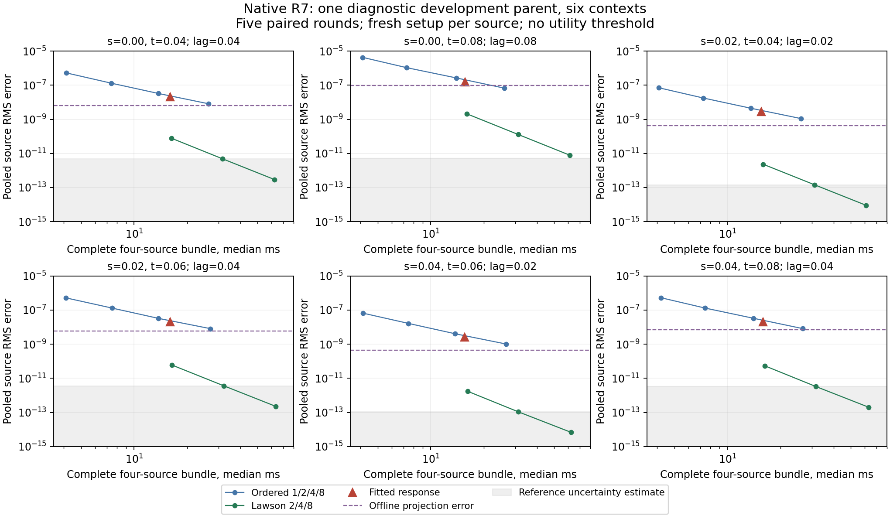
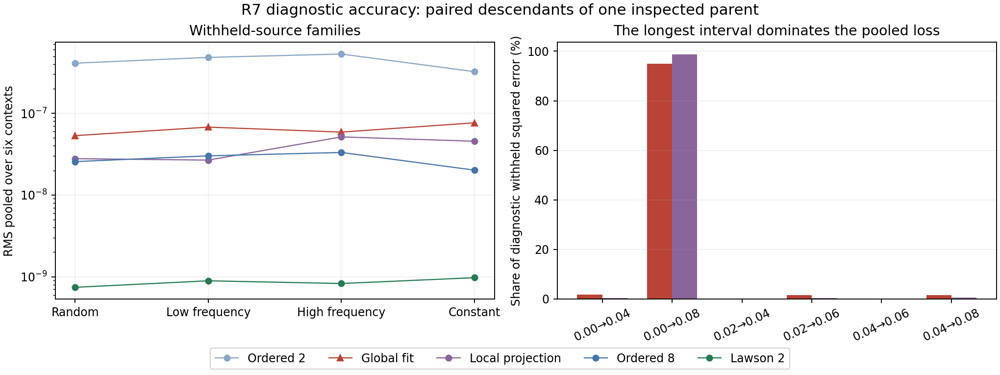

# Native R7 review — job 2939

**The native run completed correctly. The current learned response has no
established practical advantage over the classical controls.** It improves on
its two-panel base, but two-step Lawson achieves much smaller measured errors
at nearly the same complete cost. The data identify structural coverage and a
resolved sampled-span residual; regularization remains confounded with
coefficient prediction. Reference noise and optimizer failure do not explain
the main errors. A larger encoder is not yet the justified next step.

This is a review of retained evidence from source **`43837c5`**, not a new
numerical campaign. No new teachers, training candidates or model evaluations
were generated. All four parents were previously inspected development fields;
there is one diagnostic parent with paired source/time descendants. Historical
Tangent Response A PASS / B STOP remains unchanged.

## Receipt and integrity

Run: `launch-65e5bfaf1fd945f08fbfeb2726b2c29e-a1`, native CPU job **2939**.
The native worker ran from 2026-10-15 23:45:22 to 23:46:43 UTC, with 4 CPUs,
8 GiB and a 20-minute allocation. Application elapsed time was **81.27 s**;
the study stage's internal elapsed time was **44.39 s**.

The independent audit verified:

- Exactly **298/298** expected JUnit cases; zero failures, errors, skips or duplicates.
- **192/192** accepted source queries, including separately accepted U and G
  references; **2,112/2,112** metric rows and **336/336** timing bundles.
- 252 stage source files and the 632-file native aggregate against immutable
  Git source `43837c5`; both protocols match the committed prelaunch contracts.
- 541 stage artifact hashes, all 192 query-array hashes and 551 required
  portable Raven artifacts. The original prepared contract and profile bytes
  are now present and match their recorded hashes.
- Global selection before diagnostic truth; each diagnostic local fit sealed
  before its withheld directions. The global fit used 48 training-calibration
  queries; candidate selection used 24 validation-withheld queries.
- All 2,112 science rows and 336 raw timing rows match the Raven exports.

Independent numerical replay also reproduces all **2,112 metric rows exactly**
from retained arrays, all 192 design factorizations, local/global objectives
and validation selection. Local predictions reproduce exactly; reconstructed
global predictions differ by at most **8.88e-16** from streamed inference.
All **49 sensitivity maps and 245 perturbation scenarios** were checked.

Stage source fingerprint:
`abe17b47d43b50d0ca8fb797a4faf76dce8307898ff60835d00c0f985061df9c`.
Uploaded ZIP SHA-256:
`9fafcb17b9afb5657319894fc0cb127851fe15ba054cc670dc3e53671b47bbe8`.
The archive has 567 regular entries, 31,185,289 compressed bytes and
41,200,501 uncompressed bytes. No archive code was executed.

Native and Raven application status is COMPLETED with exit zero. Final
independent Slurm accounting is absent: `scheduler_outcome=unknown`; RUNNING
in the allocation fields is the startup snapshot. External scheduler stdout/
stderr were not included, but the four stage streams are portable. These
limitations do not turn the recorded successful application into a failed run.

Worker telemetry has 81 samples, nine partial samples from process churn,
71 valid CPU intervals and no missed samples or observer errors. Maximum
sampled summed RSS was **1.645 GiB**. This can count shared pages repeatedly
and is neither allocation-wide nor method-specific peak memory. Supervisor
telemetry is separate; this run establishes no GPU result.

## Action accuracy and complete cost

The table pools squared physical errors over the **24 diagnostic withheld
source/context queries** and then takes the square root. Timing ranges are
per-context medians of five paired rounds, each evaluating all four withheld
sources with fresh setup for each source. They are not confidence intervals.

| Method | Pooled physical RMS | Worst nodal error | Median four-source bundle, range across contexts |
| --- | ---: | ---: | ---: |
| Ordered 2: learned model's base | 4.433e-7 | 2.790e-6 | 7.29–7.51 ms |
| Fitted global response | 6.466e-8 | 4.234e-7 | 15.52–15.97 ms |
| Local unregularized projection | 3.937e-8 | 3.465e-7 | Offline label-informed fit; not a deployed timing competitor |
| Ordered 8 | 2.771e-8 | 1.744e-7 | 26.04–27.03 ms |
| Fixed Lawson 2 | 8.637e-10 | 7.545e-9 | 15.93–16.41 ms |

The global fit improves pooled RMS **6.86 times** over its base but remains
**2.33 times worse** than ordered 8 and **74.9 times worse** than Lawson 2.
Across the individual contexts, Lawson 2's measured RMS is **73–1,506 times
smaller**, while its median bundle cost is only about **1.9–4.0% greater**.
Equivalently, the fitted method is **1.9–3.8% faster** than Lawson 2 in those
medians. The paired fitted/Lawson timing ratios cross one in three of the six
contexts. That small observed median difference is not a reliable practical
cost margin or a predeclared utility pass.

Ordered 8 is more accurate but slower than the fit. Lawson 2 also has a
slightly greater observed median time. Consequently this review does not
claim strict Pareto dominance over the fit or a demonstrated matched-tolerance speedup.
It establishes that **Lawson 2 is the important near-cost classical control**,
not that the current learned model is competitive for a specified application
accuracy target. No such practical threshold was frozen in R7.
Lawson 2 does descriptively dominate ordered 8 in all six contexts on median
time, pooled RMS and maximum error; ordered 8 alone is therefore an inadequate
benchmark for the learned model's utility.

Inside the 44.39-second study, reference acquisition took **9.773 s**, global
fitting/selection **0.00504 s**, all 24 local fit sets **0.01431 s**, and the
336 recorded benchmark bundles **7.479 s**. These are nested components of
study elapsed time, not separate costs to add to it. Explicit operation counts
omit anchor/autograd transform internals; complete measured timing includes
their execution.



The gray region is an empirical reference-uncertainty estimate. A plotted
Lawson 4/8 discrepancy below it cannot substantiate that many digits of true
accuracy. The much larger fitted and projection residuals remain resolved.
The dashed line shows an offline calibration-fit projection's withheld error;
it is not an operator lower bound or a zero-cost deployable competitor.

## What the fits diagnose

### 1. The selected quadratic objective was minimized successfully

Validation selected `ridge_1e-10`, retaining initialization and `ridge_1e-6`
as alternatives. Validation action MSE fell from **6.664e-13** to
**5.332e-15**. The selected augmented system's condition number is **65.60**.
The original smoke's different matrix had condition approximately 4.77e10
before the earlier numerical repair; these two numbers are not a controlled
same-matrix comparison.
Its objective is `3.622e-14`, comprising data loss `5.980e-15` and ridge penalty
`3.024e-14`; the numerical gradient norm is `1.482e-24`.

Positive ridge gives a unique conditional minimizer in exact arithmetic.
The recorded gradient-gap calculation is an FP64 diagnostic, not a rounding
certificate. There is no evidence here that running an optimizer longer would
solve the accuracy/cost problem. Conversely, minimizing this penalized training
objective does not minimize every withheld physical error. The penalty is
about **83.5% of this objective**, so regularization bias remains a plausible
part of the gap; it must not be conflated with numerical solver failure.

### 2. Rank 25/40 follows from the training layout

For each of the five branches, the coefficient map uses eight features:
five are constant within a parent (`1`, state mean, reaction scale, diffusion
scale and state variance), and three vary with interval. With only two training
parents, the five static columns have rank at most two. Therefore

    rank(context feature matrix) <= 2 + 3 = 5,
    rank(global 40-column action design) <= 5 branches * 5 = 25.

The observed 12-by-8 training feature matrix has rank five, and the global
action design has rank 25. Each local five-branch calibration design has full
rank five, with condition numbers approximately **105–136**. This distinguishes
local branch identifiability from global feature identifiability.

More source directions or time samples on the same two parents cannot remove
this particular upper bound. Adding generic model parameters would not add
independent information. At least five independent static-feature rows are
necessary to identify all five static columns, and that count alone is not
sufficient: actual singular values and physical coverage must also qualify.
The four inspected parents collectively give feature rank seven, not eight.
These are design-rank facts, not claims that the spatial response operator has
rank five or 25.

### 3. Local coefficients leave room for improvement, but span error remains

The local unregularized projection improves on the global fit. On the
diagnostic withheld sources its pooled error is **1.64 times smaller**. It
beats ordered 8 on five of the six diagnostic contexts, but at the longest
interval `(s,t)=(0,0.08)` its RMS is **9.578e-8**, compared with **6.637e-8**
for ordered 8 and **2.113e-9** for Lawson 2. Its calibration RMS there is already
**8.707e-8**, so the issue is not solely failure to transfer to withheld sources.

This is a resolved residual in the five-branch span on the sampled calibration
sources, with additional withheld-source evidence. It is not a full-operator
representation floor or a universal statement about all states/grids. A
full-operator audit is the appropriate next discriminator before changing the
architecture on the assumption that scalar coefficient prediction is enough.

The local positive-ridge oracle is a different control. At global lambda
`1e-10` it uses the correctly induced local penalty
`lambda_c=lambda/(pi_q*||eta||²)`, with `pi_q=1/12`, and has diagnostic pooled
RMS **1.847e-7**—worse than the globally shared fit. Independent local fits
relax global coupling while retaining their own induced penalties; they are
not the same joint objective. Their small-lag branches scale like `tau³`, so
fixed coefficient penalties can strongly suppress corrections when the data
term scales like `tau⁶`. A poor local ridge result does not prove lack of
representational capacity; the separate unregularized projection is essential.

For the two diagnostic contexts with lag `0.02`, the local `1e-10` ridge keeps
only **18.6–18.8%** of the strongest data direction and approximately
**1.4–1.6e-5** of the weakest. Objective-preserving numerical equilibration
cannot remove this statistical shrinkage. Changing the penalty is a new
objective, not an additional numerical repair. Likewise, the global/projection
gap changes both regularization and access to local calibration labels; it
does not isolate a deficiency in the coefficient predictor.

### 4. Reference-sized perturbations do not explain the current errors

The global label-to-coefficient gain is approximately **49,573**, close to
the exact-arithmetic ridge bound of 50,000. However, the normalized
label-to-withheld-prediction gain is only **1.225**. Large coefficient gain
is not automatically large output instability.

The declared aggregate uncertainty ball has weighted label radius
**9.252e-12**. Its leading prediction-gain direction changes pooled withheld
predictions by **1.134e-11 RMS**; the actual independent-minus-refined label
scenario changes them by **4.215e-14 RMS**. These are respectively **0.01438%**
and **0.00005348%** of the fitted error pooled over all withheld queries.
This comparison uses the stated aggregate withheld norm across all splits,
not the diagnostic-only table above or a bound for every individual source.

These are empirical uncertainty scenarios, not guaranteed bounds on true
teacher error. Within that declared scenario, teacher noise is much too small
to account for the measured approximation errors. Tightening already accepted
reference tolerances is not the first useful intervention.

The unregularized projection has coefficient gains of **1.74e5–1.17e7**.
Its prediction-sensitivity maps and perturbation scenarios were not retained.
The positive-ridge robustness result must not be transferred to that separate
projection control.

### 5. The longest interval dominates the physical loss

Equal context/source/cell mass does not give equal relative-error importance.
The `(0,0.08)` context contributes **94.25%** of the fitted training-calibration
squared error, **95.75%** of validation-withheld error and **94.93%** of
diagnostic-withheld error. For the local projection, that interval contributes
**98.64%** of diagnostic-withheld error.

This is a consequence of the declared absolute physical-error objective, not
a reporting bug. A future change to relative-error, lag-normalized or
application-tolerance weighting would define a different objective and must
be frozen prospectively. It cannot be presented as a repair of the original
objective or tuned on these diagnostic outcomes while retaining a confirmation
label. Different contexts use different sources; these numbers alone do not
establish a convergence order.

### 6. A relative metric can conceal the remaining correction error

Pooled diagnostic RMS of the matched-mean feedback `(U-G) z` is **0.01520**.
The remainder actually fitted, `(U-P) z`, has RMS **4.433e-7**, approximately
34,284 times smaller. Classical `P` already supplies most of the spatial
feedback. The same fitted absolute error of `6.466e-8` is consequently:

- **0.000425% of the full spatial feedback `(U-G) z`**;
- **14.585% of the fitted remainder `(U-P) z`**.

These are ratios of pooled RMS values, not averages of per-query ratios.
Both signals are resolved against reference uncertainty, but they answer
different questions. Keep full-action, feedback and fitted-remainder errors
visible alongside absolute physical error and complete cost. A tiny feedback
percentage alone does not establish that learning recovers the residual well
or improves an endpoint or trajectory at an application's required tolerance.



## Decision and next eligible work

**Accept native execution and R7 identification evidence. Keep architecture,
solver-utility, GPU and fresh-confirmation gates closed.** There is no reason
to repeat this unchanged study. The next work should answer the remaining
mechanism questions in this order:

1. **Design and verify a bounded full-operator audit.** On predeclared tiny
   contexts, compare the independent fundamental matrix with the five branch
   matrices under the same physical mass norm. Separate minimum Frobenius
   residual, the spectral residual of that fit, reference uncertainty and
   FP64 error. Count all 25 canonical source columns explicitly. This is a
   representation audit using full operator labels, not withheld-source
   prediction or fresh confirmation. Any contexts chosen from this review are
   adaptive development choices and must be labelled accordingly.
2. **Derive the analytic classical correction before adding a predictor.**
   Work out the BCH/Magnus coefficients for the exact ordered backbone and
   its time-dependent potential, then verify signs and time terms against
   independent static and nonautonomous tiny matrices. Existing commutator
   branches must earn their place against an analytic coefficient control.
   Keep fixed Lawson 2/4/8 in the complete-cost comparison. Derivation and
   implementation verification precede collecting new comparison labels.
3. **Repair identification only under a new protocol.** If the span is useful,
   use physically varied training parents with a full-rank, adequately scaled
   feature design, or reduce the feature map to what is identifiable. Choose
   regularization and physical task weighting on declared training/validation
   data. Do not interpret the oracle/global gap as proof that a neural encoder
   is needed; regularization and objective differences remain confounders.
4. **Change the operator family only if the capacity audit warrants it.**
   Candidate directions are composition over shorter response panels or
   additional time-ordered/noncommuting branches, followed by a small learned
   residual around a verified classical base. Their added path, derivative,
   stencil and transform work must be charged. An equally treated block-source
   reuse experiment is another possible product, with an explicit graph/cache
   contract. None is implemented, selected or validated by this review.

A learned residual on a classical base, BCH/Magnus corrections, operator
composition and conditioned coefficients all have established predecessors.
This evidence does not establish novelty. Any subsequent architecture proposal
must state its narrower contribution and compare the same implemented action
against those baselines. R8–R11 are not automatic successors to a green R7 job.

## Short term legend

| Term | Meaning in this review |
| --- | --- |
| U | Full spatially varying linearized response along the original anchor |
| G | Response using the matched spatial-mean potential on that same anchor |
| P | The two-panel ordered classical response used as the learned base |
| U−P / U−G | Remainder being fitted / spatial-feedback estimand; different signals |
| Source | Vector acted on by a fixed response operator; not a parent field |
| Context | Parent, physics, grid, anchor and absolute source/stop times |
| Calibration / withheld | Directions used for the stated fit / excluded from it; validation withheld still selects a candidate |
| Projection oracle | Label-informed five-coefficient least-squares diagnostic; not a deployable model or an operator-norm guarantee |
| Ridge | A positive coefficient-norm penalty; improves uniqueness/stability but can bias predictions |
| SVD / rank | Singular-value decomposition / number of independent design directions under the declared numerical threshold |
| RMS / maximum | Root mean square under normalized physical cell mass / largest absolute nodal error |
| Lawson 2 | Fixed two-step exponential integrating-factor RK4 response, including fresh anchor work |
| BCH / Magnus | Baker–Campbell–Hausdorff product expansion / time-ordered exponential expansion; analytic controls require the correct nonautonomous derivation |
| Gain | Amplification in a specified input/output norm; coefficient gain differs from prediction gain |
| Work–precision | Accuracy together with complete measured cost for the identical task |
| RSS | Sampled resident memory; process-tree sums are not allocation or per-method peaks |

The broader notation remains in the [R7 design](../../docs/RESPONSE_PRECONDITIONER_R7_DESIGN.md)
and [architecture proposal](../../docs/TDN_ARCHITECTURE_PROPOSAL_20261015.md).

## Reproducing this review

Use a fresh extraction directory inside the checkout. The retained archive is
validated by its fixed SHA-256, entry type, path, duplicate and size checks.
The scripts load numeric NPZ files with `allow_pickle=False` and never execute
uploaded Python or shell files. The integrity auditor reads immutable committed
source through Git; the numerical reviews operate on retained arrays only.

```bash
bundle_dir=results/native-response-preconditioner-r7-2939
archive="$bundle_dir/launch-65e5bfaf1fd945f08fbfeb2726b2c29e-a1-r7-review-20261015T234901899703Z.zip"
extracted=.runtime/native-r7-2939-reproduction
python "$bundle_dir/extract_evidence.py" "$archive" "$extracted"
evidence="$extracted/launch-65e5bfaf1fd945f08fbfeb2726b2c29e-a1"
python "$bundle_dir/audit_receipt.py" --repository . --evidence "$evidence" \
  --output "$extracted/integrity-review.json"
OMP_NUM_THREADS=1 OPENBLAS_NUM_THREADS=1 MKL_NUM_THREADS=1 \
  PYTHONDONTWRITEBYTECODE=1 .venv/bin/python "$bundle_dir/review_science.py" \
  "$evidence/outputs/study" --output "$extracted/scientific-review.json"
OMP_NUM_THREADS=1 OPENBLAS_NUM_THREADS=1 MKL_NUM_THREADS=1 \
  PYTHONDONTWRITEBYTECODE=1 .venv/bin/python "$bundle_dir/review_cost_sensitivity.py" \
  --study "$evidence/outputs/study" > "$extracted/cost-sensitivity-review.json"
MPLCONFIGDIR="$PWD/.runtime/cache/matplotlib" \
  OMP_NUM_THREADS=1 OPENBLAS_NUM_THREADS=1 PYTHONDONTWRITEBYTECODE=1 \
  .venv/bin/python "$bundle_dir/plot_review.py" "$evidence/outputs/study" \
  "$extracted/figures"
```

See `scientific-review.json` and `cost-sensitivity-review.json` for the precise
aggregates and numerical replay discrepancies; `integrity-review.json` records
all provenance checks and limits. `bundle-manifest.json` hashes this review's
retained inputs, scripts, reports and figures, excluding itself. Raw native
artifacts remain immutable inside the original ZIP.

The [review verification receipt](review-verification.json) records fresh
extraction and byte-for-byte reproduction of all three JSON reviews and both
PNG figures, plus script syntax, local links and Bash-example checks. It
distinguishes these review checks from the 298 uploaded native verifier cases.
