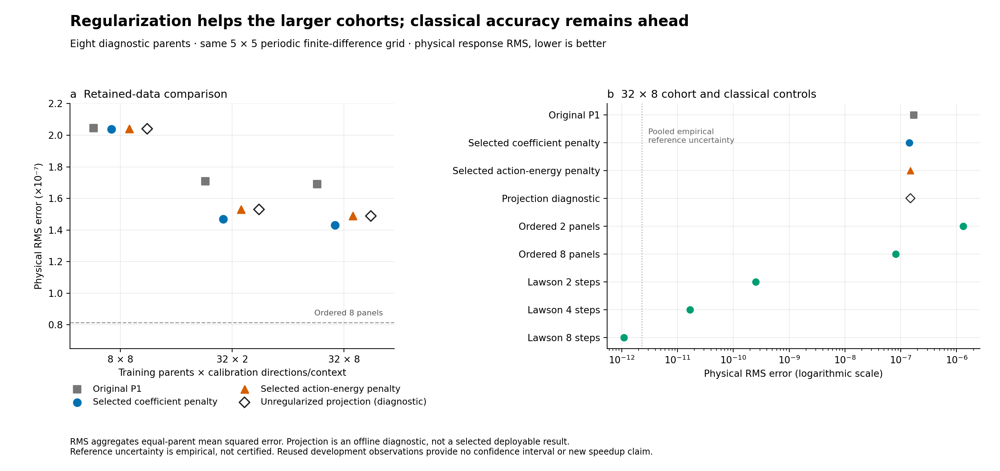
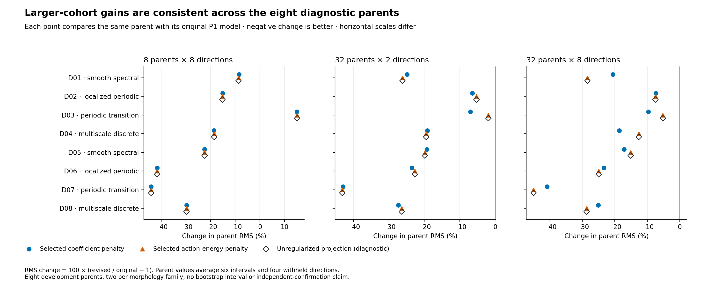
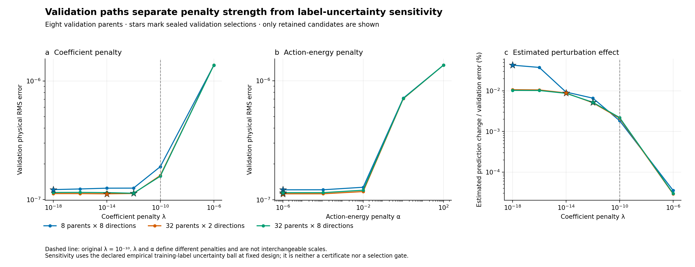
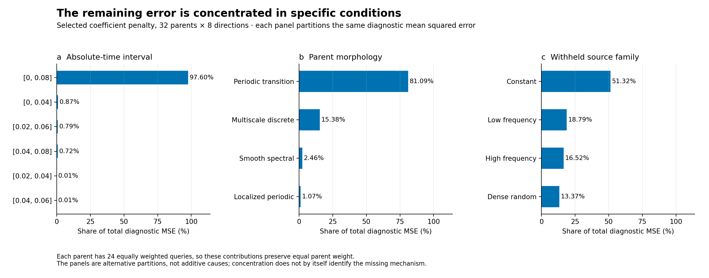
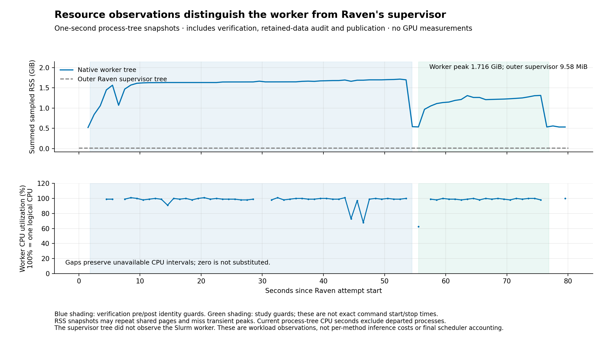

# Native P1R regularization review — job 2951

**Reviewed 15 October 2026, America/Los_Angeles.** Run
`launch-630d054468ab4bb7915d33cc9482ebf2-a1`, source
`4d0e0498ebb4f218b58934227aebc7619be2d165`.

The native audit completed successfully, including verification, research-metric
publication and packing. Independent replay reproduces every physical metric.
Weaker coefficient regularization improves the largest cell's diagnostic RMS by
**15.44%**, but its error remains **1.754 times ordered eight and 567.9 times
Lawson two**. The original penalty was part of the accuracy problem; changing
it does not make the current response competitive with the strongest controls.

The next proposed gate separates **coefficient identification from branch
expressiveness**, using the existing training-parent arrays. It is not a larger
data acquisition, architecture launch or automatic promotion. This review fits
no new model, acquires no reference and measures no new inference timing.

## 1. Execution and evidence integrity

| Layer | Recorded outcome and independent review |
| --- | --- |
| Upload | Both parts, reconstructed ZIP and all 6,228 file hashes match; 201,602,818 uncompressed bytes |
| Native verification | Exact 585/585 required JUnit cases, with no failures, errors, skips or duplicates |
| Numerical study | COMPLETED; 39 candidates, six selections, all 19,584 metric rows and 2,688 retained input queries |
| Failures and eligibility | No failed candidates or missing/unresolved metric slots; the three training projections are deliberately ineligible |
| Selection | Validation-only choices; original training/validation prefixes and new selection seals retained |
| Metric replay | All 607,104 query fields, 23,664 parent fields, 1,705 group fields and 27,648 parity fields reproduce exactly |
| Prediction replay | 13,824 affine and 13,824 five-branch checks; 9,216 historical predictions remain bitwise unchanged |
| Fit/sensitivity replay | 14,086 checks across all 39 candidates, six choices, 36 perturbation maps and 15 action-energy shrinkage identities |
| Wrapper and Raven | Both COMPLETED, exit zero; scientific metrics published and packing completed |
| Scientific promotion | None; previously inspected development data, with historical B STOP unchanged |

The [integrity audit](integrity-review.json), [metric replay](metrics-review.json),
[fit/sensitivity review](science-review.json) and
[resource review](cost-telemetry-review.json) retain the detailed checks.
No uploaded scripts or document instructions were executed. The committed
`native-review.zip` is the exact reassembled upload, SHA-256
`c1b847269855135459e865d655aba316a3e0e21d77afcdf0763d29af2c47d262`.

The worker ran **20:41:46–20:43:06 PDT on 15 October**
(03:41:46–03:43:06 UTC on 16 October), using a four-CPU, 8-GiB, 20-minute
allocation. Native wrapper elapsed time was **79.865 seconds**; numerical
verification took **50.331 s** and the study **17.658 s**. These scopes differ
and are not additive cost categories. The study stayed within its 600-second
budget. The eight optional cloud Raven compatibility checks are separate from
the 585 checks actually executed by this native worker.

Five native identity checks cover preflight and both sides of verification and
study. All report source/input equality, including the persisted final study
check before publication and packing. Numerical source-before/source-after
fingerprints match the implementation receipt. This closes the missing final
wrapper-check issue that affected the earlier P1 packing failure.

The export intentionally omits one duplicate registered ZIP,
`outputs/native/portable-study-evidence.zip` (121,133,097 bytes). Its original
input/prediction files and packing inventory are retained and hash-checked.
Thus 57 of 58 registered artifact paths exist literally in the export; the
declared deduplication is not a missing scientific result. The absent duplicate
ZIP's bytes cannot be independently rehashed from this export. Original run
files and statuses were not rewritten.

Raven's retained terminal record and application exit agree. A separate final
Slurm accounting receipt is absent; the allocation's `RUNNING` snapshot was
captured at startup and must not be treated as final job state.

## 2. What the audit changed

The response still uses five branches, eight fixed state/physics/time features
and 40 affine readout weights on the original 5 × 5 periodic same-grid FD bank.
The two 384-query cells, 8 parents × 8 directions and 32 × 2, preserve the
equal-label comparison. The largest 32 × 8 cell uses 1,536 training queries.

Each cell has zero correction, six positive coefficient ridges, five positive
action-energy strengths and an offline unregularized training projection.
Validation independently selects one readout per positive-penalty family,
including zero. All six choices precede this audit's access to diagnostic and
training-withheld numeric arrays. All these physical parents were previously
inspected, so the access ordering does not make them fresh confirmation.

Evaluation uses 1,152 original withheld queries: 768 from training parents,
192 validation and 192 diagnostic. Seventeen methods give 19,584 slots: six
selected readouts, three original P1 readouts, three projections and five
classical controls. There are eight diagnostic parents, six contexts and four
withheld source families per parent. Parent fields are the independent units.

## 3. Regularization helped, with substantial qualifications

Physical RMS on the diagnostic parents; lower is better:

| Training cell | Selected coefficient ridge | Original P1 | New coefficient ridge | RMS reduction | New action-energy arm |
| --- | ---: | ---: | ---: | ---: | ---: |
| 8 × 8 | `1e-18` | `2.04503e-7` | `2.03850e-7` | 0.32% | `2.04081e-7` |
| 32 × 2 | `1e-14` | `1.70786e-7` | `1.47029e-7` | 13.91% | `1.53049e-7` |
| 32 × 8 | `1e-12` | `1.69111e-7` | `1.42995e-7` | 15.44% | `1.48889e-7` |



The largest-cell gain appears on **all eight diagnostic parents and 174 of 192
queries**. Its maximum pointwise error falls 6.82%, from `2.07636e-6` to
`1.93473e-6`. This is a useful within-bank improvement, not just a different
normalization or a better-looking validation objective.

The eight-parent result is weaker. Validation RMS falls **35.91%**, but
diagnostic RMS falls only **0.32%**, and maximum error rises **55.07%**.
Seven diagnostic parents improve. The remaining periodic-transition parent,
`diagnostic-002-2026101803`, worsens by 14.94% in parent RMS and accounts for
79.96% of this cell's diagnostic MSE. Its influence is a property of the
declared squared-error objective, not an aggregation bug. Keep that parent in
the primary result; a favorable average over the other seven is not a repair.



Even the largest cell's validation maximum rises 5.21% while validation RMS
falls 28.13%. The protocol selected physical MSE, not worst-case error. A lower
selected MSE therefore does not promise improvement of every metric.

The 32-parent ridge optima lie **inside** the tested strength menu. Going still
weaker worsens validation there. The eight-parent optimum reaches the weakest
tested boundary, but that does not justify extending all menus or adopting one
universal tiny penalty.

At equal 384-query training demand, the newly selected 32 × 2 fit has **27.87%
lower diagnostic RMS** than 8 × 8. At 32 parents, quadrupling directions from
two to eight reduces diagnostic RMS only **2.74%** and worsens validation RMS
by **1.08%**. These compare the complete per-cell validation-selection procedure;
their selected strengths differ. They do not isolate a fixed-penalty causal
effect or justify a larger acquisition campaign.
No final winner across cells/families was selected by this protocol. The largest
cell is discussed as a fixed comparison, not promoted because it has the lowest
observed diagnostic error; 32 × 2 has the lower validation RMS.

## 4. What the action-energy and optimizer controls establish

The coefficient objective is

`||sqrt(W)(A w - b)||² + lambda ||w||²`,

with equal parent mass. The action-energy objective instead adds
`alpha ||sqrt(W) A w||²`. On these full-column-rank designs its solution is
exactly the unregularized training readout divided by `1 + alpha` in exact
arithmetic. Every action-energy selection uses **`alpha=1e-6`**, almost no
shrinkage. Its predictions are correspondingly close to the offline training
projection. This control provides no evidence for a stronger physical prior or
new operator mechanism.

| Coefficient selection | Effective degrees of freedom | Penalty share of objective | Objective-gap bound / data MSE |
| --- | ---: | ---: | ---: |
| 8 × 8, `1e-18` | 39.58 | 0.00452% | `2.13e-14` |
| 32 × 2, `1e-14` | 30.33 | 0.609% | `1.46e-20` |
| 32 × 8, `1e-12` | 17.50 | 14.264% | `1.67e-23` |

Original P1 fits retained only about 6.6–6.8 effective degrees of freedom.
Releasing that shrinkage exposes useful directions. Yet nearly unregularized
40-degree fits are not best on the larger cells: the largest selected ridge
has about **3.96% lower diagnostic RMS** than its training projection.

Independent replay evaluates the saved coefficients, spectra, original-coordinate
objectives, validation scores and sensitivity maps. It does not refit them.
Numerical optimization gaps are far below physical data loss. Running an
iterative optimizer longer cannot recover the remaining discrepancy while
retaining the same quadratic objective. This distinguishes minimizing the
chosen objective from choosing an objective/model that generalizes.

The reported quadratic gap formula uses full augmented curvature and ordinary
FP64 evaluation. Its exact-arithmetic inequality is not an outward-rounded
computer certificate. Effective degrees of freedom count response-smoother
flexibility, not independent physical laws.

## 5. Sensitivity is small for the tested perturbations

For the selected coefficient ridges:

| Cell | Estimated-ball validation prediction change | Actual retained-reference perturbation change | Validation RMS |
| --- | ---: | ---: | ---: |
| 8 × 8 | `5.233e-11` | `1.601e-13` | `1.215e-7` |
| 32 × 2 | `9.947e-12` | `6.223e-14` | `1.120e-7` |
| 32 × 8 | `5.944e-12` | `5.398e-14` | `1.132e-7` |

The largest estimated-ball effect across all six selected readouts is only
**0.0432% of validation error**. Actual retained teacher/refinement differences
induce at most about **0.000132%**. Under these fixed-design label perturbations,
reference noise is too small to explain the large model residual or erase the
observed improvements.

The reference ball is empirical, not a proven enclosure. This analysis does not
cover feature/design uncertainty, different physical parents, longer times,
larger grids or accumulated rollout errors. Some predicted uncertainty changes
exceed validation reference uncertainty itself; small relative to model error
does not mean below every numerical scale. Large coefficient norms alone are
also not proof of instability: their assembled action and perturbation map are
the relevant quantities here.



## 6. The classical gap and residual structure remain decisive

| Diagnostic method | Physical RMS |
| --- | ---: |
| Ordered two, original backbone | `1.30447e-6` |
| Largest selected coefficient fit | `1.42995e-7` |
| Ordered eight | `8.15400e-8` |
| Lawson two | `2.51812e-10` |
| Lawson four | `1.67195e-11` |
| Lawson eight | `1.10106e-12` |

No selected ridge or action-energy model beats Lawson two on any individual
validation or diagnostic query. The largest fit's RMS is still **567.87 times**
Lawson two's and **1.754 times** ordered eight's. Exact Lawson-four/eight gains
near reference uncertainty remain unresolved; they should not be used for
high-precision superiority ratios. Lawson two already establishes the large
accuracy gap.

No new inference timings were measured. P1 previously found Lawson two at
about 1.027 times the original learned complete-bundle time on its fixed
subset. That is historical context, not a measured cost for these new
coefficients or a new matched-tolerance speedup result.

For the largest selected ridge, diagnostic MSE concentrates in:

- **97.60%** on the longest interval, `[0, 0.08]`;
- **81.09%** on the two periodic-transition parents;
- **73.91%** on `diagnostic-002-2026101803` alone;
- **51.32%** on constant source directions;
- **97.32%** in within-action spatial variation, with **2.68%** in mean error.

These are overlapping views, not additive shares. A constant source still
produces a spatially varying response in a heterogeneous reaction field.
The concentration motivates a mechanism test of time/state conditioning and
spatial branch expressiveness; it does not prove which is responsible. The
model's error is about **10.96% of the correction remainder RMS**, and all 192
diagnostic errors exceed ten estimated reference uncertainties.



The mean/spatial split is computed per action before averaging parents:
`MSE = average(mean(error)²) + average(spatially_centered_error²)`.
Opposite signed means cannot cancel in the mean component. Historical P1
pooled-centering fields are preserved; this review uses the explicit P1R fields.

## 7. Costs, telemetry and portable research reporting

New audit computation records **6.500 s** of input reads, **0.214 s** of penalty
setup, **3.589 s** of candidate computation and **1.676 s** of evaluation.
The **0.653 s** sensitivity component is already included in candidate time.
These components do not exhaust or sum independently to wall time. Original
reference/design costs, **124.080 s / 12.186 s**, are reused historical costs,
not new acquisition. Overlapping training-cell labels are not acquired twice.

Raven contains **95 compact research rows plus two stage rows**. Publication
completed before optional packing. This fixes the lifecycle failure seen in
P1, where packing prevented scientific series from being published.

Allocated-worker telemetry has **79 samples**, including ten partial samples
caused by process-tree changes. Maximum sampled summed RSS is **1.716 GiB**;
valid CPU samples have median **98.99%** and maximum **101.00%** of one logical
CPU. One numerical thread was used. These are sampled worker process-tree
observations, not per-method peaks, guaranteed peak memory or total allocation
accounting. Shared pages may be counted more than once.

The separate Raven supervisor shows about **9.58 MiB RSS** and zero recorded
CPU seconds. Its scope does not describe the worker's scientific computation.
There are no GPU observations. The original data, logs and both telemetry
scopes remain in the retained archive.



## 8. Proposed next gate, without expanding the current study

Read the [specific structural-attribution proposal](proposal-review.md).
It uses only the 32 original training parents and six contexts per parent:

1. Fit one shared five-branch coefficient vector per context from its eight
   existing calibration sources. Freeze and seal these **192 local diagnostic
   fits**, then score their four withheld sources: **768 local prediction rows**.
2. Separately compute **192 evaluation-only projections** onto the branches
   stacked across those four withheld sources. All four must share one vector;
   a per-source fit would abandon the source-linear operator question.
3. Compare the frozen global feature-conditioned model, calibration-fitted local
   diagnostic and evaluation-only projection on identical actions. Preserve
   conditioning, numerical rank, label sensitivity and signed error cross terms.
   A TSVD residual is a resolved sampled-subspace diagnostic, not an automatic
   full-span or full-operator lower bound.

Validation and diagnostic parents have no retained calibration sources. Do not
fit their withheld truth and relabel the result as out-of-sample prediction.
Local truth-informed coefficients are never deployable competitors and do not
establish that an encoder can infer them from a new state.

If local calibration fits transfer well while the global model fails, investigate
the fixed state/time coefficient features. If even the joint withheld projection
leaves a large resolved error, investigate branch construction and a specific
missing nonautonomous operator contribution. If the projection is good but
calibration fits transfer poorly, investigate source identification and
conditioning first. Independent analytic BCH/Magnus controls and complete
classical cost remain necessary before attributing gains to learned novelty.

This is a **proposal to preregister**, not implemented or executed work. The
existing evidence does not justify a larger batch, a generic encoder, a revised
success criterion or another unchanged P1R run. Any new response
construction must preserve forcing linearity, cheap deployable conditioning and
the structural limits, and then earn its accuracy/cost claim. Classical ridge,
local least squares and shrinkage controls are not novelty claims.

## 9. Term and abbreviation legend

| Term | Meaning in this review |
| --- | --- |
| P1 / P1R | Original parent/source scaling study / retained-data regularization audit |
| Parent | One physical initial field; contexts and directions from it are paired descendants |
| Context | A parent with fixed physical parameters and source-to-response time interval |
| Source / forcing direction | Input vector acted on by the linear tangent-response operator |
| `U`, `G`, `P` | Full tangent response, matched-mean response, and ordered-two backbone in the physical experiment; projector `P` in the separate proposal has a different meaning |
| Branch | One fixed source-linear correction operator; five branch actions form the local dictionary |
| Global 40 / local five | Shared eight-feature map for five coefficients / proposed per-context five coefficients fitted using labels |
| `A`, `b`, `W`, `w` | Retained design, target correction, normalized physical/parent weights, fitted coefficients |
| Ridge / Tikhonov | Classical quadratic regularization of a least-squares objective |
| `lambda` / `alpha` | Coefficient-ridge / action-energy strength; definitions and units differ |
| OLS / projection | Unregularized least squares; current P1R projection is a global training diagnostic, distinct from the proposed local withheld projection |
| SVD / TSVD | Singular-value decomposition / decomposition retaining only directions above a declared cutoff |
| Effective degrees of freedom | Trace of the regularized prediction smoother, not matrix rank or a count of physical mechanisms |
| MSE / RMS | Mean squared physical error / its square root, queries averaged within parents then parents equally |
| Mean / spatial component | Squared spatial mean of each action error / remaining within-action error variation |
| Empirical uncertainty ball | Estimated training-reference perturbation radius; no guaranteed containment claim |
| Lawson / ordered panels | Classical exponential-integrating-factor control / composition-based response approximation; number denotes its panel/step count |
| FD / FP64 | Same-grid finite differences / 64-bit floating-point arithmetic |
| RSS | Resident memory sampled over the allocated worker's local process tree |
| BCH / Magnus | Classical noncommutative expansions proposed as independently derived analytic controls |
| B STOP | Historical scientific gate retained unchanged; successful execution is not scientific promotion |

## 10. Read-only reproduction

Keep all outputs inside this checkout and use its existing standalone venv.
Extract into a fresh directory; no original run is changed:

```bash
.venv/bin/python results/native-response-preconditioner-regularization-2951/replay_upload.py \
  --output .runtime/p1r-2951-review-replay
```

The individual review scripts accept explicit input and output paths; see their
`--help` and `review-receipt.json` for the exact executed commands. They verify
retained arrays and saved coefficients, rather than fitting new coefficients
or generating truth. Numerical replay uses NumPy with `allow_pickle=False`.
Figures contain descriptive paired observations without confidence intervals.
`manifest.json` hashes all retained review files except itself. Original evidence
stays inside the byte-identical ZIP; review JSON/CSVs and plots are derived files.
