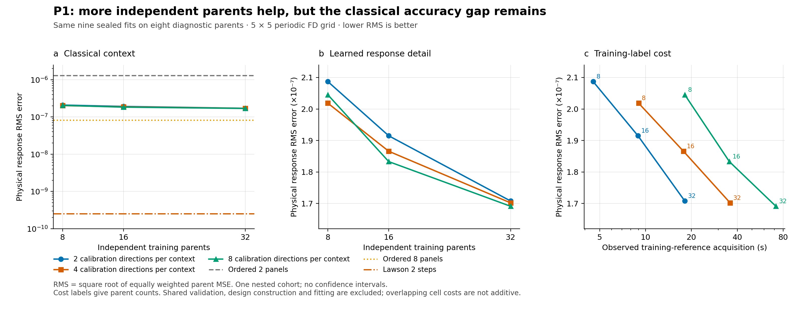
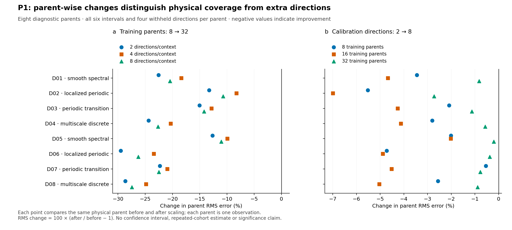
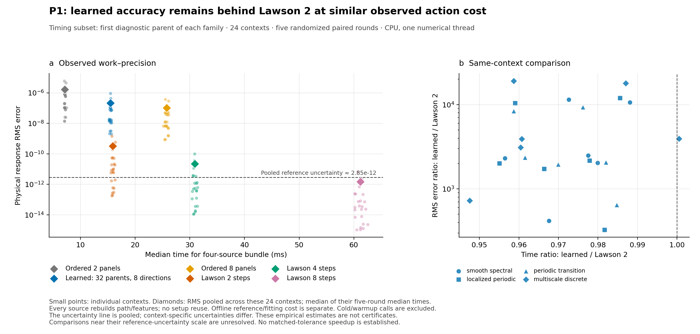

# Native Phase 1 scaling review — job 2944

**Reviewed 15 October 2026, America/Los_Angeles.** Run
`launch-0e144975eb4b433492fe55d75d209ef2-a1`, original source
`7d0c6201ad3ec399568492077066bd359c59829e`.

The numerical study completed and its retained evidence passes independent
replay. The native wrapper failed afterward while writing its packing
inventory. Preserve the original **FAILED** status; no repeat of this study is
needed to recover its scientific results. The export repair at `9aa2050` made
this evidence available without changing the experiment.

Scientifically, broader physical-parent coverage helps, while additional
random training directions have small returns. The learned response still
loses substantially to Lawson 2 at nearly the same observed complete-action
cost. The next useful question is whether the present regularization and
physical coefficient model suppress useful corrections. This review proposes
a bounded audit of that question; it does not fit additional models, acquire
references, launch the next phase, or establish novelty or solver superiority.

## 1. What completed, and what failed

| Layer | Retained outcome and independent check |
| --- | --- |
| Upload | All three part hashes, reconstructed ZIP hash, and all 7,757 member hashes match; 320,826,795 uncompressed bytes |
| Native verification | Exact original 388/388 JUnit cases; zero failures, errors, skips or duplicates |
| Numerical study | COMPLETED; 2,688 accepted reference pairs, all nine fits, 16,128 measured metric rows, 1,008 timing bundles; no missing/failed/unresolved slots |
| Selection | All nine validation-only selections and nested data prefixes verified; all seal before diagnostic and training-withheld truth |
| Numerical replay | All 338,688 physical metric values (16,128 × 21) reproduce exactly; 10,368 affine/five-branch prediction checks pass |
| Fit/cost replay | 8,201 checks pass, including all 27 candidate objectives, nine seals, spectra, 1,008 timing slots and 144 work–precision rows |
| Wrapper and Raven | FAILED, exit 2, after science during packing; final separate Slurm accounting remains unknown |
| Scientific promotion | None; development evidence, without a predefined utility pass threshold |

The original allocation was four CPUs, 8 GiB and 20 minutes. It ran from
**17:36:16 to 17:44:22 PDT on 15 October** (00:36:16–00:44:22 UTC on 16 October).
Native elapsed time was **485.897 s**; the study used **448.786 s**, within its
900-second limit. Original JSON timestamps and all statuses remain unchanged.
The later export-repair suite has 404 required local checks; those must not be
reported as the 388 checks actually run by this native job.

### Packing failure

The worker successfully created `outputs/native/portable-study-evidence.zip`
(96,233,919 bytes) containing 7,680 raw study files and its embedded manifest.
Every packed raw file matches the corresponding sealed study file. The compact
embedded manifest alone occupies **1,232,048 bytes including a newline**, already
larger than the old JSON writer's **1,048,576-byte** limit. The final packing
record would additionally include archive and cost metadata. Its write failed,
leaving the complete ZIP and no `packing.json`.

The old exporter then encountered its separate 64 MiB per-file reader limit
on this retained ZIP. The subsequent repair streams large files and assigns
explicit bounded inventory sizes. These are two evidence-handling limits,
not a teacher, optimizer, accuracy-threshold or model-execution failure.

Science-series publication followed packing, so this run's `metrics.jsonl`
contains only the verification row. Its scientific Raven charts were not
published. The raw JSON/CSV, arrays and new figures below preserve the results;
this review does not backfill or relabel the original Raven attempt.

### Provenance and resource limits

The [integrity audit](integrity-review.json) compares the contract against
immutable Git source `7d0c620`, the original prelaunch receipts, 643-file native
identity, 263 numerical source files, four before/after stage snapshots, exact
protocols, verification release, artifact manifests and access journal.

A qualification matters: native `source_unchanged: true` was recorded after
verification, and the pre-study aggregate identity check passed. Packing failed
before the final post-study aggregate identity check. Both numerical stages'
source-before/source-after snapshots match, covering the numerical program and
its preconditioner scripts. This supports the study's source identity; it does
not establish that the unexecuted final aggregate check succeeded.

Worker telemetry has 485 samples, eight partial samples and no observer errors.
Maximum sampled summed process-tree RSS is **1.631 GiB**; maximum sampled CPU
utilization is about **101% of one logical CPU**. Numerical work used one thread.
Process churn makes coverage partial, and shared pages can be counted more than
once. These are neither per-method peaks nor allocation-wide measurements.
Raven supervisor RSS peaks at only about 9.8 MiB; its scope differs from the
allocated worker. There are no GPU observations and no independent final Slurm
termination receipt in this upload.

## 2. The actual experiment

P1 holds the five response branches, eight fixed features, 40 affine weights,
physical action loss and original positive-ridge menu fixed. It varies:

- Physical training parents: nested prefixes of 8, 16 and 32.
- Calibration directions per parent and interval: nested prefixes of 2, 4 and 8.

There are 32 training, eight validation and eight diagnostic parents, balanced
across smooth spectral, localized periodic, periodic-transition and multiscale
discrete fields. All are 5 × 5 same-grid finite-difference problems. Each parent
has six absolute-time intervals: `[0,.04]`, `[0,.08]`, `[.02,.04]`, `[.02,.06]`,
`[.04,.06]`, `[.04,.08]`. The last four use the original anchor path; they do not
restart it at the source time.

Each context has four withheld source families: dense, low-frequency,
high-frequency and constant. Validation alone selects among zero readout and
ridge strengths `1e-10` and `1e-6`. All nine selected fits use `1e-10`. The largest
32 × 8 cell was predeclared for timing; its timing eligibility was not chosen by
diagnostic ranking.

Shared query pairs are acquired once: 1,536 training-calibration, 192 validation,
768 training-withheld and 192 diagnostic queries. Each query contains the full
response `U` and matched-mean response `G`. All pairs pass the frozen reference
checks. Numerical replay reads retained arrays with `allow_pickle=False`; it
executes no uploaded code and acquires no new truth.

## 3. What data scaling tells us

Diagnostic parent-balanced physical RMS, lower is better:

| Training parents | 2 calibration directions | 4 directions | 8 directions |
| ---: | ---: | ---: | ---: |
| 8 | 2.08696e-7 | 2.01840e-7 | 2.04503e-7 |
| 16 | 1.91481e-7 | 1.86573e-7 | 1.83287e-7 |
| 32 | 1.70786e-7 | 1.70190e-7 | 1.69111e-7 |



**More parents help on this bank.** At a fixed direction count, 8 → 32 parents
reduces diagnostic RMS by 15.68–18.17%; at eight directions the decrease is
17.31%. Every diagnostic parent improves at both parent doublings. Validation
shows the same broad trend. This supports better physical coverage within this
family, rather than attributing the problem solely to within-parent sampling.

**More directions are much less valuable here.** At 32 parents, 2 → 8 directions
reduces diagnostic RMS by just **0.981%**, while quadrupling training queries
from 384 to 1,536 and their observed reference cost from 18.102 to 71.728 s.
At eight parents, increasing from four to eight directions actually worsens
every validation and diagnostic parent. Source-count improvement is not
monotone and does not guarantee generalization.

**The equal-label comparison is especially useful:** 32 parents × 2 directions
and 8 parents × 8 directions both require 384 training queries. The former has
**16.49% lower diagnostic RMS and 15.78% lower validation RMS**. This separates
allocation of a fixed label budget from simply paying for more labels.



These are descriptive observations from one nested parent order and one source
order. Eight diagnostic parents, including only two per morphology, do not
support a universal learning law, population confidence interval or an automatic
64/128-parent expansion. P1 changes the parent distribution from R7, so a pooled
P1-versus-R7 score difference does not isolate training-set size. Some production
seed prefixes were inspected by the implementation fixture. This is development
evidence and cannot be relabeled fresh confirmation.

## 4. The classical controls remain decisive

Full diagnostic-bank results, all eight parents and 192 withheld queries:

| Method | Physical RMS | Maximum absolute error | Interpretation |
| --- | ---: | ---: | --- |
| Ordered 2, learned backbone | 1.30447e-6 | 1.65803e-5 | Zero learned correction |
| Learned 32 × 8 | 1.69111e-7 | 2.07636e-6 | 87.04% less RMS than its backbone |
| Ordered 8 | 8.15400e-8 | 1.03629e-6 | Learned RMS remains 2.074 times larger |
| Lawson 2 | 2.51812e-10 | 2.91790e-9 | Learned RMS remains 671.576 times larger |
| Lawson 4 | 1.67195e-11 | 2.24414e-10 | Many individual errors are near reference uncertainty |
| Lawson 8 | 1.10106e-12 | 1.68516e-11 | Individual errors are unresolved at the uncertainty scale |

All eight diagnostic parents favor the learned response over its ordered-two
backbone, but favor both ordered eight and Lawson two over the learned response.
A comparison only against initialization would miss the main practical issue.



Timing covers the predeclared first diagnostic parent from each family: four
parents × six intervals = 24 contexts. Each method performs a complete four-source
bundle, rebuilding path, features and action for each source. There is one first
measurement, one warmup and five randomized paired rounds per context/method:
`24 × 6 × 7 = 1,008` bundles, or 4,032 source calls. The first measurement follows
accuracy acquisition; it is not a cold-process startup. No cross-source cache
or vectorized throughput is measured.

Across these contexts, the median of five-round median bundle times is
**15.479 ms learned versus 15.887 ms Lawson 2**. Independently computing each
paired-round `Lawson 2 time / learned time`, taking its median within context,
then its median over contexts gives **1.0270** (context range 0.99986–1.06011).
These are different descriptive summaries; neither establishes a reliable
practical speed margin. Learned RMS is 328–19,098 times Lawson 2's in these same
contexts, median ratio 2,420. The full-bank pooled ratio 672 above is a different
aggregation, not a contradiction.

Ordered eight takes about 1.668 times the learned time under the same paired
summary, but learned context RMS is median 2.043 times larger. Only one of the
24 contexts favors the learned method in both time and error. No matched-tolerance
superiority, full-solver speedup or offline-cost break-even is established.

### Reference resolution

References use refined Lawson integration and an independent DOP853 check;
their disagreements estimate uncertainty, not a certified bound. The learned
remainder is resolved on every query: its size is at least 5,831 times the
estimated reference RMS uncertainty. The largest fit's diagnostic error is
at least 1,504 times that uncertainty. Teacher noise is therefore not a plausible
explanation for the present learned error under this estimate.

Lawson 2 errors exceed ten estimated reference uncertainties on all 192
diagnostic queries and all 24 timing contexts. Lawson 4 does so on only 25/192
queries and 3/24 contexts; Lawson 8 on none. The raw high-order measurements
remain visible, but precise gains between near-floor controls are unresolved.
These resolution counts are checks against empirical uncertainty, not proofs
of teacher accuracy.

## 5. What the fitting diagnostics reveal

The conditional objective is

\[
J(w)=\|Aw-b\|_W^2+\lambda\|w\|_2^2,
\qquad b=(U-P)z,
\]

with total training weight one and equal weight per independent parent.
Here `A` contains the frozen feature/branch action columns. Positive `lambda`
makes this quadratic strictly convex. Its stationary solution is the unique
minimizer in exact arithmetic; the implemented augmented SVD solves that fixed
problem without changing its original coefficient penalty.

All nine original weighted designs have **rank 40**, with condition numbers
about **1.16e5–3.22e5**. The selected `lambda=1e-10` scaled augmented systems have condition numbers about
**63.76–64.27**. The old two-parent R7 rank-25 obstruction is absent on this
sampled design. This does not prove full response-operator accuracy or sufficient
model capacity.

Recomputed objective gradients are around `1e-25`; the diagnostic
`||grad J||²/(4 lambda)` is around `1e-40`, versus training data MSE around
`1e-14`. Ordinary FP64 arithmetic is not an interval proof, but this discrepancy
strongly argues against spending more optimizer iterations on the same objective.

The important remaining issue is **regularization bias and identification**:

- Every validation selection lands at the smallest offered ridge, `1e-10`.
- Its penalty contributes **59.2–67.6%** of the total selected objective.
- In the original weighted coefficient coordinates, ridge attenuates each
  singular component by `sigma_j² / (sigma_j² + lambda)`, where `sigma_j`
  is a singular value of `sqrt(W) A`.
- The sum of these factors, the linear smoother's effective degrees of freedom,
  is only **6.60–6.80**, despite numerical rank 40. Only six singular directions
  retain more than half their unregularized strength.

Thus, full numerical rank and a well-solved regularized system coexist with
strong shrinkage of most data directions. Effective degrees of freedom is a
property of this sampled regularized regression, not the physical dimension
of the PDE. A large penalty share alone does not prove harmful regularization,
and choosing the smallest offered ridge does not prove that a smaller value
will generalize. Together they justify testing that question explicitly before
blaming optimization or adding an encoder.

Because weights are normalized to total one, additional parents do not simply
reduce the ridge's strength by increasing the number of rows. The same absolute
lambda remains coupled to the physical scale and feature parameterization.
Changing feature scaling without transporting the penalty changes the model's
prior; a future generalized penalty must state that change mathematically.

## 6. Error structure and the centering caveat

For the largest fit, diagnostic squared error is concentrated in:

| Partition | Share of diagnostic MSE |
| --- | ---: |
| Longest interval `[0,0.08]` | 94.60% |
| Periodic-transition parents | 79.42% |
| Constant source directions | 54.05% |
| Per-action spatial fluctuation error | 94.59% |
| Per-action mean-component error | 5.41% |

The first three rows are overlapping partitions and must not be added. The last
two form a true decomposition. A constant source can develop a spatial response
under a heterogeneous reaction coefficient; it is not necessarily an easy
mean-only test. These strata suggest time-dependent/spatial correction structure
is worth examining, but cannot identify a missing branch by themselves.

For each action error field `e_q`, with physical spatial average `m_q`, the exact
identity is

\[
\mathbb E_q\langle e_q^2\rangle_x
=\mathbb E_q m_q^2+\mathbb E_q\langle(e_q-m_q)^2\rangle_x.
\]

Parent balancing is applied outside each parent's equally weighted queries.
The original per-query centered metrics are correct. However, the original
aggregate field named `centered_rms` instead computes
`sqrt(E[e²] - E[m]²)`. It includes between-query variation in mean errors,
assigning it to the pooled centered term; a signed average mean can therefore
hide a substantial mean-error component. It is a globally centered pooled
metric, not the RMS of per-action spatial fluctuations.

This review preserves and replays that original field, and additionally records
`mean_component_rms = sqrt(E[m²])` and
`spatial_centered_rms = sqrt(E[< (e-m)² >])` in
[scientific-review.json](scientific-review.json). The decomposition above uses
these derived fields. Full physical RMS and maximum comparisons are unaffected.
A future reporting version should give the pooled field an explicit name and
publish both decomposition terms, preserving historical schema meaning.

Relative denominators also matter. Largest-fit error is only about `1.232e-5`
of full spatial feedback `(U-G)z`, but **0.12964**, or **12.964%**, of the fitted
remainder `(U-P)z`. The much larger feedback denominator makes the same error
look small. Neither normalized score replaces absolute accuracy or the strongest
near-cost classical comparison.

## 7. Costs and what they do not establish

| Recorded component | Seconds |
| --- | ---: |
| Reference acquisition, all 2,688 unique pairs | 124.0804 |
| Design construction | 12.1856 |
| All nine fit/selection cells, outer timer | 0.80375 |
| Accuracy evaluation | 91.3586 |
| All timing observations, including first/warmup | 26.3615 |
| Study wall time | 448.7864 |
| Native wrapper wall time | 485.8967 |

These scopes are nested components of wall time, not independent costs to add
to it. Unlisted overhead includes orchestration, artifact handling and work
outside the narrow component timers. The nine per-cell reference demands
overlap: summing them would falsely charge 219.593 s of training acquisition.
The global ledger charges each label once; individual requirements remain
visible for future budget design. Validation labels are shared across cells.

Per-action timing excludes offline reference acquisition and fitting. Including
these costs cannot create an absent matched-accuracy advantage. Memory telemetry
covers the worker rather than individual methods, and these tiny CPU grids do
not predict GPU throughput or large-grid scaling.

## 8. Recommended next gate — proposal, not executed work

**Prioritize a bounded regularization/physical-prior audit before a larger
architecture or another broad data acquisition.** This is a refinement of the
phase ordering, moving the P4 question ahead of a large P2 acquisition study.
P1 is complete; no phase is automatically launched by this recommendation.

1. **Freeze a retained-bank development audit.** Keep the same response family,
   actual targets, parent weights and fixed evaluation axes. Compare the original
   ridge against a predeclared bounded path of weaker positive penalties and a
   separately named unregularized projection diagnostic. Freeze numerical-rank,
   prediction-stability and validation-selection rules before fitting. Record
   data loss, penalty, spectrum and withheld physical errors separately. Use the
   existing sealed arrays where eligible; no new labels are needed to ask this
   first question. The already inspected diagnostic bank remains development.
2. **Separate penalty from coefficient-map limitations.** A generalized Tikhonov
   candidate `||Aw-b||_W² + lambda ||L(w-w0)||²` should declare `L`, its nullspace,
   and the physical meaning of `w0`. For `lambda > 0`, strict convexity requires
   `ker(sqrt(W) A) ∩ ker(L) = {0}`, or a separately declared positive ridge term.
   Compare an analytically derived prior and a plain ridge path at identical
   data and cost. This is a changed objective, not a numerical rescaling repair.
3. **Use the rawest structural controls before growing the model.** On a frozen
   tiny subset, apply the response to all 25 canonical basis directions, with
   physical normalization and independently qualified reference matrices.
   Compare the complete matrix and sampled-direction errors. Derive the
   nonautonomous BCH/Magnus correction of the exact ordered backbone, including
   time derivatives of the potential. Test the coefficient placement and
   source-linearity algebra directly. These new calculations require their own
   bounded protocol; this review has not run them.
4. **Make the next architecture decision conditional.** If weaker or physical
   regularization improves eligible held-out errors stably, repair the objective
   first. If local branch projections succeed while the global map fails, revise
   state/time features or the conditional map. If local/full-operator residuals
   persist, revise the response branches or time composition. A larger neural
   encoder cannot by itself fix a missing action span. Lawson 2 remains the
   near-cost control in every branch of this decision.
5. **Only then buy new coverage or task-specific labels.** P2 should compare
   parent-focused stratified acquisition against D-/E-optimal acquisition under
   equal acquisition cost. P3 should introduce actual defect/quadrature sources
   while retaining generic source stress tests. A subsequently frozen fresh
   evaluation bank is needed for claims beyond the inspected development data.

Before any practical utility claim, freeze the same physical error tolerances,
requested outputs and cost boundary for learned and classical methods. Compare
complete work to the same accuracy requirement, including setup, rejected work,
classical fallback and offline amortization where relevant. No post hoc lowering
of passing thresholds is justified here. Endpoints, rollouts, derivatives,
continuum fidelity, GPU utility and novelty each remain separate unanswered
questions.

## 9. Term and abbreviation legend

| Term or symbol | Meaning in this review |
| --- | --- |
| TDN / P1 / R7 | Project name / first data-scaling phase / preceding bounded representation-identification study |
| PDE / FD | Partial differential equation / the specified same-grid finite-difference spatial operator |
| Parent | Independently generated physical initial field; unit of splitting and paired scientific analysis |
| Context / query | One parent and absolute-time interval / that context with one source direction |
| Calibration / withheld | Eligible training source / source excluded from coefficient fitting |
| Validation / diagnostic | Bank selecting the declared ridge candidate / bank evaluating already sealed candidates |
| `p032-s08` | 32 training parents and eight calibration directions per context |
| `U`, `G`, `P` | Full tangent response, matched-mean response, ordered-two response backbone |
| `z`, `(U-P)z`, `(U-G)z` | Source vector, learned target remainder, full spatial feedback |
| Ordered panels | Compositions of potential and heat actions approximating the linear response |
| Lawson 2/4/8 | The implemented fixed-work integrating-factor controls with 2/4/8 time steps; the suffix is step count, not a claimed method order |
| DOP853 | Independent explicit adaptive Runge–Kutta reference check, distinct from Lawson refinement |
| RMS / MSE / maximum | Root mean square / mean squared physical field error / largest absolute component error |
| Signed mean / mean-component RMS | Spatial average of each error / square root of averaged squared action means |
| Spatial-centered RMS | Square root of averaged within-action spatial variance; different from the historical pooled `centered_rms` |
| Relative error | Absolute error divided by a stated reference, remainder or feedback norm; denominator must be named |
| Reference uncertainty | Empirical refinement and cross-method discrepancy; not a proven upper error bound |
| `A`, `b`, `W`, `w` | Action design, remainder labels, fixed parent/space weights, fitted coefficient vector |
| Ridge / `lambda` | Positive quadratic coefficient penalty / its strength in the original coordinates |
| SVD | Singular value decomposition used for stable fitting and rank/conditioning diagnostics |
| Rank / condition number | Independent sampled design directions / ratio of largest to smallest relevant singular value |
| Augmented system | Weighted data rows plus penalty rows; its condition differs from the original design's |
| Effective degrees of freedom | Sum of ridge singular shrinkage factors; not spatial operator rank or a count of learned physical laws |
| Optimality gap diagnostic | FP64 estimate based on gradient and positive ridge; concerns the fixed training objective only |
| Tikhonov / prior | General quadratic penalty / declared preferred coefficient or physical behavior |
| BCH / Magnus | Baker–Campbell–Hausdorff composition expansion / time-ordered exponential expansion; nonautonomous terms must be included |
| D-optimal / E-optimal | Acquisition maximizing information determinant / improving its smallest eigenvalue |
| Defect | Anchor derivative minus governing vector field; a task-specific response source |
| Bundle / paired round | Four complete sequential source calls / shared repetition comparing all methods in randomized order |
| Work–precision / matched tolerance | Error versus observed work / methods satisfying the same predeclared accuracy requirements |
| FP32 / FP64 | 32-/64-bit floating point; references and model use FP64 on the actual stored FP32 initial field |
| CPU / GPU / RSS | Central/graphics processor / sampled resident set size of observed processes |
| MiB / GiB | Binary byte units, 2^20 / 2^30 bytes |
| Raven / Slurm | Run lifecycle and analytics system / scheduler allocating the worker |
| SHA-256 / seal | Cryptographic file/content digest / frozen candidate identity checked against that digest |
| JUnit / NPZ / JSON / CSV | Test-result XML / NumPy numeric archive / structured text data / tabular text data |
| Development / confirmation | Evidence available for further design / new untouched evaluation after freezing the full procedure |
| Novelty | A substantiated distinction from prior work; neither passing tests nor this learning curve establishes it |

## 10. Retained files and reproduction

The byte-exact uploaded archive is [native-review.zip](native-review.zip), SHA-256
`caaacb862df0e272763340b69f523e66884c40e32013cd1ec6f0ff46eb89b6fb`.
It is the concatenation of all three uploaded parts. Their individual byte-range
hashes and every file hash are preserved in [upload-index.json](upload-index.json).
[UPLOAD_README.txt](UPLOAD_README.txt) is retained as evidence, not as executable
instructions. The orphan nested ZIP is intentionally preserved to substantiate
the packing failure; this duplicates some raw data in the original upload.

| Review artifact | Purpose |
| --- | --- |
| [extract_evidence.py](extract_evidence.py) | Exact upload/part/file hash verification, safe fresh extraction, no uploaded-code execution |
| [audit_receipt.py](audit_receipt.py), [integrity-review.json](integrity-review.json) | Immutable provenance, completeness, selection ordering, packing and telemetry audit |
| [review_science.py](review_science.py), [scientific-review.json](scientific-review.json) | Read-only numeric replay, parent/stratum learning curves, correct spatial/mean decomposition |
| [review_cost_fit.py](review_cost_fit.py), [cost-fit-review.json](cost-fit-review.json) | Saved-fit objective/spectrum checks, paired timing and unique-label cost accounting |
| [plot_review.py](plot_review.py), [figures/](figures/) | Portable PNG/SVG charts from retained data, without refitting |
| [review-verification.json](review-verification.json), [bundle-manifest.json](bundle-manifest.json) | Executed checks and retained-file hashes |

After pulling this review with no relevant jobs active, use the following
**read-only replay**, which submits no jobs. It requires the project venv with
NumPy and matplotlib, plus repository Git history containing `7d0c620`.
Extraction uses a fresh checkout-contained directory and leaves the interactive
terminal open on failure. Roughly 400 MiB of additional local space is needed.

```bash
if cd /home/rahel/TDN; then
  bash <<'BASH'
set -euo pipefail
review="$PWD/results/native-response-preconditioner-scaling-2944"
replay="$PWD/.runtime/p1-review-$(date -u +%Y%m%dT%H%M%S%N)"
mkdir -p "$replay/cache" "$replay/tmp"
export TMPDIR="$replay/tmp" MPLCONFIGDIR="$replay/cache"
export PYTHONDONTWRITEBYTECODE=1 OMP_NUM_THREADS=1 MKL_NUM_THREADS=1 OPENBLAS_NUM_THREADS=1
.venv/bin/python "$review/extract_evidence.py" \
  --archive "$review/native-review.zip" --index "$review/upload-index.json" \
  --output "$replay/evidence"
run="$replay/evidence/launch-0e144975eb4b433492fe55d75d209ef2-a1"
.venv/bin/python "$review/audit_receipt.py" \
  --repository "$PWD" --evidence "$run" --output "$replay/integrity.json"
.venv/bin/python "$review/review_science.py" \
  --study "$run/outputs/study" --output "$replay/science.json"
.venv/bin/python "$review/review_cost_fit.py" \
  --study "$run/outputs/study" --output "$replay/cost-fit.json"
.venv/bin/python "$review/plot_review.py" \
  --study "$run/outputs/study" --output "$replay/figures"
printf 'Read-only review written to: %s\n' "$replay"
BASH
fi
```

The completed native run remains historical evidence. Do not rerun the unchanged
study or rewrite its failed wrapper status to make the dashboard green.
