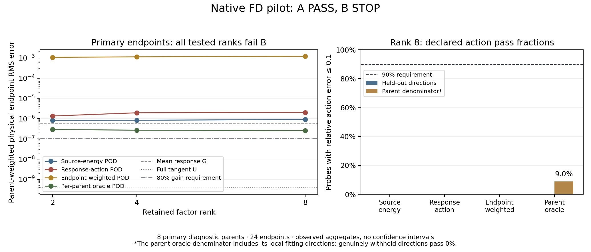

# Native Tangent pilot: mechanism passes, compression stops

The uploaded FD pilot supports **A PASS** and the recorded **B STOP**. The full
spatial tangent improves the physical response mechanism, but the tested compact
maps do not retain that benefit on the required independent actions/endpoints.
The compression phase also has two reporting failures; it is not a fully
verified completed campaign. Learning/calibration/utility must remain gated.

## Scientific result

Stage A retained all **24 primary diagnostic endpoints from eight independent
parents**. Its parent-weighted arithmetic mean physical RMS errors were
`E_G = 5.5635189367e-7` and `E_U = 3.8770411562e-10`: a ratio of **1434.99**.
All eight parents had uncertainty-separated improvement. No primary queries
were missing, unresolved, duplicated or precision-limited. This validates the
declared oracle mechanism on this development bank; it does not establish a
learned model, practical solver speedup or population-level guarantee.

Stage B measured **5,760 source probes** over 144 queries/32 parents, producing
86,400 method-action rows and 2,160 endpoint rows. Each of 15 methods has every
declared action and endpoint identity exactly once. All measured actions resolved.
Its gate uses 4,128 requested probe slots: 4,075 nontrivial and 53 response-null;
the endpoint criterion uses the same 24 primary diagnostic queries.
Sixty ancillary endpoint rows remain unresolved (four nonprimary queries across
15 methods); they are preserved and cannot rescue primary promotion.

The requirements remain: relative action error at most 0.1 for at least 90% of
each held-out scope, worst relative error at most 0.3, and at least 80% retained
aggregate endpoint improvement at rank at most eight. Every reusable candidate
at ranks 2/4/8 stopped. No primary endpoint or required action was missing or
unresolved. Representative rank-eight endpoint outcomes are:

| Tested map | `E_L`: compressed physical RMS | Retained oracle gain |
| --- | ---: | ---: |
| Shared source-energy POD | `9.07495e-7` | −63.16% |
| Shared response-action POD | `2.01321e-6` | −262.04% |
| Shared endpoint-weighted POD | `1.19145e-3` | −214203.68% |
| Per-parent oracle response POD | `2.57360e-7` | 53.78% |

The oracle map's published held-out-parent fraction is **268/2,987 = 8.97%**.
Every one of those passing probes is a direction used in that parent's local
fit. Its genuinely withheld directions pass **0/2,304**, including **0/1,088**
on training parents. The parent oracle is nondeployable representation evidence;
this percentage is not learned held-out-parent generalization. Task-residual
methods remain separately reported `NOT_APPLICABLE` to reusable-operator
promotion. Their rank-eight primary endpoint RMS is `2.10657e-3`; no task-only
positive result rescues B.

## What caused the compression problem

The evidence points to several distinct limitations, rather than one proven
sign or grid-scaling error:

1. **Unstable coefficient fitting.** The recorded retained design condition
   ratios approach `1e10`, with `rcond=1e-10` and zero ridge. The endpoint-weighted
   rank-eight map has coefficient norm about 16,478. One probe has a true action
   RMS of `1.32647e-8`, but FP64 prediction error **505.917**; the response-action
   example has true RMS `2.20665e-8` and error **0.910272**. These are large
   absolute errors. FP32 sensitivity is much smaller, so roundoff and small
   denominators alone do not explain them. A stable regularized refit has not
   yet established the remedy.
2. **Shared maps omit their conditioning state.** Their grouping uses target,
   grid and domain lengths, and prediction receives the source and times. They
   pool backgrounds and physical coefficients that change the true response.
3. **The named state oracle also pools conditions.** It groups by parent;
   two diagnostic parents each contain 12 distinct input/physics states.
   This is broader than one fixed operator condition. Its failure does not
   establish the rank needed by each individual conditioned operator. Other
   fixed-context parents also fail unseen directions.
4. **The fixed output basis itself loses action energy.** Coarse-grid shared
   response POD at rank eight discards 43.84% of fitting action energy, giving a
   66.21% aggregate relative RMS projection-error lower bound in that fixed
   basis. Conversely, the fine-grid endpoint-weighted basis loses only about
   `7.5e-12` of fitting energy while its decoder remains unstable. Capacity and
   coefficient recovery therefore need separate diagnostics.
5. **A strong endpoint mechanism does not imply operator low rank.** For short
   FD intervals, `(U-G)/(h-s)` tends to pointwise multiplication by
   `-2*r*center(a_s)`, which is generally full rank on the grid. This local
   structure can be cheap without being low rank. Endpoint weighting also gives
   independent probes zero weight in its fit, so their accuracy tests decoder
   extrapolation as well as basis selection.

The bounded next scientific diagnostic is to separate projection error from
decoder error on the retained training labels, audit the exact state/physics
oracle grouping, and predeclare a small train-only conditioning/regularization
comparison. Preserve B STOP and its thresholds. This is not permission to train,
increase model width, expand native work or reclassify these inspected parents
as fresh confirmation.

## Native execution and infrastructure

Both native audits passed their exact **29/29 CUDA cases**, without failures,
errors, skips or duplicates. Recorded hardware/software: RTX 4090, compute
capability 8.9, driver 580.159.03, Python 3.13.13, Torch 2.10.0+cu126 and CUDA
12.6. The mechanism/action science bodies were allocated CPU work; no learned
CUDA training or utility measurements appear in this bundle. Resource telemetry
is distinct from admission readiness and scientific acceptance.
The audit body has an unconditional `native_readiness: false` detail; the
source-bound `execution.json.native_readiness.verified` records and exact
JUnit/preflight receipts establish the recorded admission outcome. That body
detail is not a failed CUDA test result.

| Phase | Units | Science seals | Completed worker/native seals |
| --- | ---: | ---: | ---: |
| Mechanism A | 292 | 292 | 292 |
| Compression B | 148 | 147 | 146 |

Job **2891** completed its compression science body in 86.11 seconds, then
failed native final reporting because `compression_results.json` is
539,255,609 bytes and was passed to a metadata reader limited to 256 MiB.
Its native worker remains FAILED. Job **2893** then failed portable verification:
the incomplete compression Raven attempt was still RUNNING and declared a
missing `summary.json`. The original ZIP/worker states are retained unchanged.

All 440 recorded worker source/job/protocol/software identities agree with the
frozen source `add29d2765520b56db76c1e400e9c437272dd29ef00a8ce88a38bef194bdabdf`
and clean commit `582c06e4bace5faa785d2abcf50e5a717dda92a0`. No source-drift
failure was recorded here. The compression prerequisite matches every one of
the 292 parent native seals and the exact A decision. These are recorded results
under that original source, not validation of subsequent code revisions.

The uploaded export has no campaign receipt or downstream fit/calibration/
learning/utility roots. Their absence limits the claims that can be made from
this package; B's unchanged non-passing decision blocks downstream promotion.

## Provenance and terms

All seven archive parts, complete archive hash, manifest hash and **24,944
retained files** passed transport verification. Independent native checks passed
11,689 retained hash comparisons (not a distinct-file count). Another 577
referenced omitted array/checkpoint hashes agree with export records, but their
bytes cannot be independently checked or replayed from this review subset.
No uploaded code, teachers, checkpoints or native numerical jobs were executed
for this analysis. The plot and statistics are derived from unchanged JSON.

| Term | Meaning here |
| --- | --- |
| FD | Finite-difference spatial target on the declared grid. |
| `G` / `U` | Matched mean-path response / full spatially varying tangent response. |
| `E_G`, `E_U`, `E_L` | Parent-weighted mean physical endpoint RMS for G, U and the compressed response. |
| RMS | Root-mean-square physical field error, with the declared spatial norm. |
| Action | Response applied to one declared source direction; relative error is measured on `(U-G)z`, not on all of `Uz`. |
| `z`, `a_s`, `center(a_s)` | Declared source direction, smooth anchor field at source time, and that field minus its spatial mean. |
| `r`, `s`, `h` | Reaction rate, source time and endpoint time; `h-s` is the remaining response interval. |
| POD / SVD | Proper orthogonal decomposition / singular-value decomposition used for bases and coefficient fitting. |
| Rank | Retained spatial factor dimension; it is not inferred from fitting one response vector. |
| Retained gain | `(E_G-E_L)/(E_G-E_U)`; negative means worse than G. |
| Condition ratio | Largest divided by smallest retained design singular value; a large value indicates sensitivity. |
| `rcond` / ridge | Relative singular-value cutoff / quadratic regularization strength. |
| FP64 / FP32 | 64-bit / 32-bit floating-point arithmetic. |
| Parent / probe | Independent input-field draw / paired source direction or time descendant. Probe count is not population sample count. |
| Science / native seal | Hash-bound scientific output / additional verified worker, allocation, reporting and resource provenance. |

Exact evidence: [A decision](A-decision.json), [B decision](B-decision.json),
[scientific audit](scientific-audit.json), [code/formula audit](formula-audit.json),
[native audit](native-evidence-audit.json), [upload index](upload-index.json)
and [transport checks](transport-check.json).

## Reporting repair and verification

The reporting change treats only the declared compression aggregate as a
separately bounded scientific payload. It verifies the existing science seal,
preserves its complete bytes in ordered UTF-8 segments, and publishes small
source descriptors on worker pages. Generic metadata remains limited to
256 MiB, produced pages to 7 MiB, Raven's default reader to 8 MiB, and portable
transport to 2 GiB. The separate scientific payload ceiling is 1 GiB; there is
no global reader-limit increase or numerical change.

Terminal worker status is published before bulk export. Structurally incomplete
attempts are retained as explicit failure evidence with their exact original
metadata, logs and recorded worker state, while their broken inventories are
excluded from portable discovery. This does not synthesize a successful native
execution or replace the original failed attempts.

All **86 reporting, telemetry and native-launch regression checks passed**, with
zero failures, errors or skips; see the [JUnit receipt](reporting-tests.xml).
A separate cloud CPU encoding audit used the actual **539,255,609-byte** sealed
native compression source. It retained **534,984 compiled records** (534,969
compression records and 15 decision records), exported and relocated a
194,282,906-byte ZIP, and reconstructed the original source SHA256 exactly.
Trusted Raven `c34f0892` validated **229 contracts and all 1,867 registered
outputs** using its unchanged default checks, with no unchecked outputs.

The actual generated project occupied 1,626,364,441 uncompressed bytes. A
conservative projection including the entire previous export and longer native
campaign names is 2,029,471,535 bytes, below the unchanged 2 GiB transport cap.
See the [scale verification receipt](reporting-scale-verification.json) and
[verification/source record](verification.json) for commands, fingerprints,
scope and limits. Exact cloud audit program snapshots are retained for
inspection: [encoding/relocation](verification-programs/tangent-native-large-science-observer.py),
[native-name projection](verification-programs/tangent-native-large-science-name-projection.py)
and [default output checks](verification-programs/tangent-native-large-science-default-output-checks.py).
Their paths describe this restored cloud workspace; they are historical
verification records rather than native scientific launch commands.
This is post-hoc reporting verification on uploaded data,
not a new native scientific execution. The original jobs remain FAILED, their
native seals remain absent, and B remains STOP.

These results already justify stopping the current scientific expansion.
Reporting repair alone does not require rerunning the mechanism/compression
campaign. Preserve this source-bound evidence; any future numerical comparison
needs a separately frozen protocol and fresh run roots after related jobs and
coordinators are terminal. Incomplete UTF-8 codepoints in a physically truncated
unsealed file are outside the demonstrated portable failure-evidence coverage;
the original native bytes and FAILED lifecycle remain preserved.
